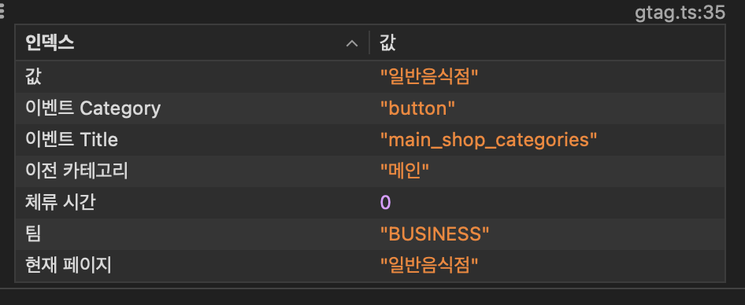

# [레거시] 해결

> **레거시 문서** · 과거 구현과 로깅을 확인하기 위한 보존 자료입니다.

[← 미래의 주변상점 - 레거시 로깅 목록](../../../../../../../event-log/05-%EB%AF%B8%EB%9E%98%EC%9D%98-%EC%A3%BC%EB%B3%80%EC%83%81%EC%A0%90-%EB%A0%88%EA%B1%B0%EC%8B%9C/README.md)

원문에 과거·새 로깅 구분이 없어 아래 정의와 참고사진을 원문 순서로 표시합니다.

원문 미기재 항목: `event_name`, `event_label`, `screen_view`, `value`, `event_category`. 값을 추정하지 않았습니다.

웹 : 

주변상점에서 메인페이지로 나갔다가 들어온 뒤 카테고리를 누르면 체류 시간이 0 혹은 1로 나오는 이슈 

→ 뒤로가기를 한 뒤 다시 들어와도 시간이 찍히게 바꿔주시면 감사하겠습니다. 

---

안드로이드 : 

시간 : ms → S 

---

원문 정보

원본 ID: `98b0221954bc82e9a1cc014e8450ac86`  
[보존 원문](../../../../../../original/notion/pages/98b0221954bc82e9a1cc014e8450ac86.md)

