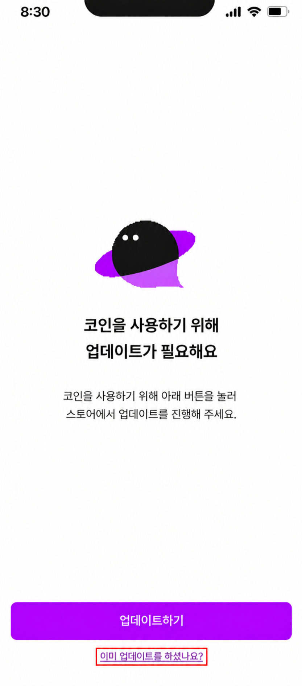

# 3. 이미 업데이트했나요 클릭
<!-- representative-note:start -->
> 이 페이지가 서비스 목록의 대표 명세입니다. 추가 원본·플랫폼별 과거 정의와 사진은 아래 보존 원본에서 확인할 수 있습니다.
<!-- representative-note:end -->

[← 강제 업데이트 로깅 목록](../../../../../../../event-log/18-%EA%B0%95%EC%A0%9C-%EC%97%85%EB%8D%B0%EC%9D%B4%ED%8A%B8/README.md)

과거 로깅·새 로깅과 각 참고사진은 원문의 구간별 연결을 유지합니다.

<!-- logging-section:new:start -->
## 새 로깅

- 설명: 강제 업데이트 화면의 이미 업데이트를 하셨나요? 링크를 클릭해 안내 팝업을 열 때 1회 기록한다.
- screen\_view: <code>forced_update</code>
- event\_name: <code>DA1</code>
- event\_label: <code>main__forced_update__app_update__already_done__click</code>
- value: 이미업데이트
- event\_category: <code>click</code>

검토사항

- 업데이트 완료 판정이나 팝업 버튼 클릭 이벤트가 아니다.
- 새 계약의 event\_label·screen\_view·event\_name은 IOS·ANDROID·WEB에서 동일하다. 실제 기능이 없는 플랫폼에는 전송하지 않는다. SDK 구현·배포·실수집 검증은 별도다.
- 기존 코드·값 차이·검토 이력은 [강제 업데이트 · 로깅 명세](../../../../../../original/notion/pages/4150221954bc81658736d9971120feaa.md)에 보존한다. 신·구 label을 한 동작에 병행 전송하지 않는다.

<!-- logging-section:new:end -->

### 참고사진 (이미 업데이트했나요 클릭)

웹 (PC·모바일 웹) — 해당 화면의 실제 이미지 미확보. 앱 이미지를 웹 이미지로 대신 표시하지 않는다.

#### 모바일

모바일 — 하단 이미 업데이트를 하셨나요? 링크만 빨간 네모로 표시했다. 사용자 제공 큰 디자인 이미지를 편집한 참고사진이며 실기기·SDK 검증 사진은 아니다.

---

원문 정보

원본 ID: `4150221954bc81a28e0fc946e1e57c27`  
[보존 원문](../../../../../../original/notion/pages/4150221954bc81a28e0fc946e1e57c27.md)

<!-- representative-related:start -->

## 추가 원본과 플랫폼별 자료

동일한 새 정의는 대표 하나로 안내합니다. 아래 플랫폼·상태는 각 원문의 표기이며 실제 지원·SDK 배포 확인을 뜻하지 않습니다. 과거 정의와 사진이 다른 경우에도 삭제하지 않습니다.

| 원본 ID·명세 | 원문 플랫폼 | 원문 상태 | 원문 보관 |
| --- | --- | --- | --- |
| [4150221954bc81a28e0fc946e1e57c27](../../../../../../../event-log/18-%EA%B0%95%EC%A0%9C-%EC%97%85%EB%8D%B0%EC%9D%B4%ED%8A%B8/_archive/original/notion/pages/4150221954bc81a28e0fc946e1e57c27.md) |
| [e2b0221954bc829e844681434ddf4197](../../../../../../../event-log/18-%EA%B0%95%EC%A0%9C-%EC%97%85%EB%8D%B0%EC%9D%B4%ED%8A%B8/_archive/original/notion/pages/e2b0221954bc829e844681434ddf4197.md) |
<!-- representative-related:end -->
