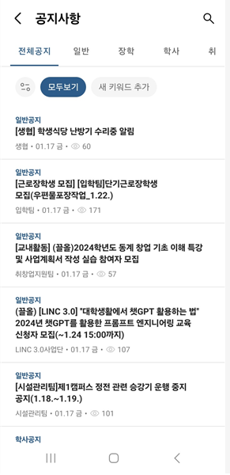

# 현행 게시판 개요

[← 현행 문서와 참고 자료](README.md)

> Notion의 현재 항목 번호를 따릅니다. 통합 명세의 표시 번호는 3-3이며, 본문에서 3-3·4-3은 통합 전 웹·앱 항목의 이력을 설명합니다. 개별 이벤트 계약을 변경하지 않았습니다.

[Notion 기준 원문](https://app.notion.com/p/69c0221954bc8267b14801439f33c216) · 원문 편집 시각: 2026-11-23T13:38:12.539Z  
조회·동기화 기준일: 2026-11-27. [조회되지 않은 참고 링크와 확인 범위](reference-status.md).

<!-- notion-body:start -->

추가 로깅 검토 — 태그 1\~9의 퍼널

기존 32개 항목에 없는 아래 행동은 현재 UI와 기존 구현을 확인한 뒤 추가 여부를 검토합니다.

### 공지사항 목록의 일반 게시글 클릭

- screen\_view: <code>main_notice</code>
- event\_name: <code>DA2</code>
- event\_label: <code>board__main_notice__notice_detail__entry__click</code>
- value: “\{공지명\}”
- event\_category: <code>click</code>
- 발생 조건: 공지 목록의 일반 게시글을 눌러 상세 화면으로 이동.
- 확인사항: 현재 5-1은 목록으로 돌아가는 동작이므로 일반 게시글 선택 이벤트의 기존 적용 여부를 확인합니다.

### 공지 검색 결과의 게시글 클릭

- screen\_view: <code>notice_search</code>
- event\_name: <code>DA2</code>
- event\_label: <code>board__notice_search__notice_detail__entry__click</code>
- value: “\{공지명\}”
- event\_category: <code>click</code>
- 발생 조건: 검색 실행 후 결과 목록의 게시글을 선택.
- 확인사항: 검색 실행과 결과 선택을 구분합니다. 검색 결과의 실제 노출 화면을 확인해 페이지 구간과 추가 여부를 확정합니다.

Firebase (<b>screen\_view</b>) 공지사항

### IOS

- 공지사항  페이지:   NoticeListViewController
- 키워드 설정 : ManageNoticeKeywordViewController

### ANDROID

- 공지사항 페이지:  ArticleActivity

Firebase (<b>screen\_view</b>) 시설물 정보

### IOS

-시설물 정보  페이지:   FacilityInfoViewController

### ANDROID

- 시설물 정보 페이지:  OperatingInfoActivity

<a href="https://app.notion.com/p/b810221954bc829fa9a181255d0d9445">커뮤니티 로깅</a>

게시판 로깅 — 기능 및 세부 기능·행동 구분

정리 기준: 2026.10.05, 태그 1\~9의 현재 활성 명세 28개. event\_label의 기능 구간은 11개입니다. 레거시 항목과 상단의 추가 로깅 검토 후보는 이 표의 집계에 포함하지 않습니다.

기준 문서: <a href="https://app.notion.com/p/4129ae650b59804fbe20e3a332b84b2a">Notion 원문</a>

### 구분 기준

- 기본 구조: <code>서비스명__페이지__기능__category</code>(4구간); 필요하면 기능 뒤에 <code>__세부기능_또는_세부행동</code>을 하나 추가합니다(5구간: <code>서비스명__페이지__기능__세부__category</code>). 마지막 구간은 항상 event\_category 단어(click, select, scroll, swipe, submit, fail, exposure, toggle)입니다.
- 서비스명: 해당 기능의 소속입니다. 공지사항 기능은 <code>board</code>, 로그인 팝업 기능은 <code>account</code>로 구분합니다.
- 페이지: 이벤트가 발생하는 화면입니다. 공용 헤더·푸터만 예외로 header·footer 고정값을 사용합니다. 그 외에는 실제 발생 화면별로 구분합니다.
- 기능: event\_label의 세 번째 구간입니다(category는 마지막 구간). 페이지가 달라도 같은 기능명을 사용하면 기능 단위로 묶어 볼 수 있습니다.
- 세부 기능·행동: 5구간 label일 때 event\_label의 네 번째 구간입니다(선택, 최대 1구간). 진입 위치, 선택한 영역, 실행 동작 등을 구분합니다. 생략된 4구간 label은 실제 행동을 명세 설명과 마지막 구간의 category로 확인합니다.
- 예시: <code>board__main__notice_entry__more_entry__click</code> → 게시판 서비스 / 메인 화면 / 공지사항 진입 기능 / 더보기 진입 / click.

### 기능상 구분

<table>
<tr>
<td>
서비스
</td>
<td>
기능
</td>
<td>
기능 범위
</td>
<td>
발생 페이지
</td>
<td>
관련 명세
</td>
</tr>
<tr>
<td>
<code>board</code>
</td>
<td>
<code>notice_entry</code>
</td>
<td>
공지사항 목록으로 진입하는 기능
</td>
<td>
<code>main</code> <code>header</code> <code>footer</code>
</td>
<td>
1-1, 1-2, 2-1, 2-2, 2-3
</td>
</tr>
<tr>
<td>
<code>board</code>
</td>
<td>
<code>notice_detail</code>
</td>
<td>
공지 게시글을 선택하여 상세 화면으로 진입하는 기능
</td>
<td>
<code>main</code> <code>main_notice</code> <code>notice_detail</code> <code>notice_search</code> <code>from_external</code>
</td>
<td>
1-3, 3-1, 3-3, 4-3, 5-2, 6-4, 9-1
</td>
</tr>
<tr>
<td>
<code>board</code>
</td>
<td>
<code>external_link</code>
</td>
<td>
외부 사이트 또는 공지 원본으로 이동하는 기능
</td>
<td>
<code>main_notice</code> <code>notice_detail</code>
</td>
<td>
3-2, 5-3
</td>
</tr>
<tr>
<td>
<code>board</code>
</td>
<td>
<code>filter</code>
</td>
<td>
공지사항 목록의 탭 선택 및 목록의 키워드 필터 선택
</td>
<td>
<code>main_notice</code>
</td>
<td>
4-1, 7-2
</td>
</tr>
<tr>
<td>
<code>board</code>
</td>
<td>
<code>notice_list</code>
</td>
<td>
공지사항 목록을 탐색하는 기능
</td>
<td>
<code>main_notice</code>
</td>
<td>
4-2
</td>
</tr>
<tr>
<td>
<code>board</code>
</td>
<td>
<code>navigation</code>
</td>
<td>
공지 상세 화면에서 목록으로 돌아가는 기능
</td>
<td>
<code>notice_detail</code>
</td>
<td>
5-1
</td>
</tr>
<tr>
<td>
<code>board</code>
</td>
<td>
<code>search</code>
</td>
<td>
공지 검색 화면 진입, 검색 키워드 선택 및 검색 실행
</td>
<td>
<code>main_notice</code> <code>notice_search</code>
</td>
<td>
6-1, 6-2, 6-3
</td>
</tr>
<tr>
<td>
<code>board</code>
</td>
<td>
<code>keyword_manage</code>
</td>
<td>
키워드 관리 화면 진입, 직접 입력·추천 키워드 선택으로 키워드 추가, 키워드 알림 수신 상태 변경
</td>
<td>
<code>main_notice</code> <code>notification_config</code> <code>notice_keyword_manage</code>
</td>
<td>
7-1, 7-3, 7-5, 7-8, 7-9
</td>
</tr>
<tr>
<td>
<code>account</code>
</td>
<td>
<code>login_popup</code>
</td>
<td>
로그인 안내 팝업의 로그인하기 및 닫기 기능
</td>
<td>
<code>notice_keyword_manage</code>
</td>
<td>
7-6, 7-7
</td>
</tr>
</table>

### 세부 기능 및 행동별 구분

아래 페이지·기능·세부 구간을 서비스명과 <code>__</code>로 연결하고 끝에 표의 event\_category를 붙이면 각 명세의 event\_label이 됩니다(세부가 '생략'이면 4구간). 7-6·7-7은 <code>account</code>, 나머지는 <code>board</code>입니다.

<table>
<tr>
<td>
명세
</td>
<td>
페이지
</td>
<td>
기능
</td>
<td>
세부 기능·행동
</td>
<td>
실제 행동 및 event_category
</td>
</tr>
<tr>
<td>
<a href="https://app.notion.com/p/6170221954bc83d1b83b81e11602d971">1-1.메인_공지사항_더보기_클</a>
</td>
<td>
<code>main</code>
</td>
<td>
<code>notice_entry</code>
</td>
<td>
<code>more_entry</code>
</td>
<td>
공지사항 더보기 클릭 event_category: <code>click</code>
</td>
</tr>
<tr>
<td>
<a href="https://app.notion.com/p/ac00221954bc825189bf81ab024cf2a4">1-2. 메인_공지사항_클릭</a>
</td>
<td>
<code>main</code>
</td>
<td>
<code>notice_entry</code>
</td>
<td>
<code>title_entry</code>
</td>
<td>
공지사항 제목 클릭 event_category: <code>click</code>
</td>
</tr>
<tr>
<td>
<a href="https://app.notion.com/p/b6f0221954bc83849a8081a8edf55550">1-3. 메인_공지사항_상세_클릭</a>
</td>
<td>
<code>main</code>
</td>
<td>
<code>notice_detail</code>
</td>
<td>
<code>entry</code>
</td>
<td>
메인 화면의 공지 게시글 클릭 event_category: <code>click</code>
</td>
</tr>
<tr>
<td>
<a href="https://app.notion.com/p/1f70221954bc825cb97001fb31b4b0ec">2-1. 헤더_공지사항_클릭</a>
</td>
<td>
<code>header</code>
</td>
<td>
<code>notice_entry</code>
</td>
<td>
<code>header_entry</code>
</td>
<td>
헤더의 공지사항 메뉴 클릭 event_category: <code>click</code>
</td>
</tr>
<tr>
<td>
<a href="https://app.notion.com/p/e640221954bc8203a98f01ff1c3f865a">2-2. 푸터_공지사항_클릭</a>
</td>
<td>
<code>footer</code>
</td>
<td>
<code>notice_entry</code>
</td>
<td>
<code>footer_entry</code>
</td>
<td>
푸터의 공지사항 메뉴 클릭 event_category: <code>click</code>
</td>
</tr>
<tr>
<td>
<a href="https://app.notion.com/p/adc0221954bc82c99b1a0195e579b8a6">2-3. 공지사항_클릭 (레거시)</a>
</td>
<td>
<code>main</code>
</td>
<td>
<code>notice_entry</code>
</td>
<td>
<code>navigation_entry</code>
</td>
<td>
앱 하단 내비게이션의 게시판 클릭 event_category: <code>click</code>
</td>
</tr>
<tr>
<td>
<a href="https://app.notion.com/p/a360221954bc8326af0781e8a69edc77">3-1. 공지사항_가장 많이 본 게시물_클릭</a>
</td>
<td>
<code>main_notice</code>
</td>
<td>
<code>notice_detail</code>
</td>
<td>
<code>popular_post_entry</code>
</td>
<td>
가장 많이 본 공지 게시글 클릭 event_category: <code>click</code>
</td>
</tr>
<tr>
<td>
<a href="https://app.notion.com/p/4620221954bc827ca78e01ec6ae51dd6">3-2. 공지사항_바로가기_클릭</a>
</td>
<td>
<code>main_notice</code>
</td>
<td>
<code>external_link</code>
</td>
<td>
<code>shortcut_entry</code>
</td>
<td>
코리아텍 등 외부 사이트 바로가기 클릭 event_category: <code>click</code>
</td>
</tr>
<tr>
<td>
<a href="https://app.notion.com/p/1220221954bc821cbf5a818cf7f633ea">3-3. 공지사항_상세_클릭 (웹·앱)</a>
</td>
<td>
<code>main_notice</code>
</td>
<td>
<code>notice_detail</code>
</td>
<td>
<code>entry</code>
</td>
<td>
공지사항 목록의 일반 게시글 클릭 (WEB) — 3-3·4-3 통합 event_category: <code>click</code>
</td>
</tr>
<tr>
<td>
<a href="https://app.notion.com/p/8f30221954bc8267912a8138c434e100">4-1. 탭 메뉴바_클릭</a>
</td>
<td>
<code>main_notice</code>
</td>
<td>
<code>filter</code>
</td>
<td>
<code>tab</code>
</td>
<td>
공지사항 목록 상단의 탭 선택 event_category: <code>select</code>
</td>
</tr>
<tr>
<td>
<a href="https://app.notion.com/p/28f0221954bc82099c08810da6e0fbb2">4-2. 공지사항 페이지_스크롤(상하)</a>
</td>
<td>
<code>main_notice</code>
</td>
<td>
<code>notice_list</code>
</td>
<td>
생략
</td>
<td>
공지사항 목록을 위·아래로 스크롤 event_category: <code>scroll</code>
</td>
</tr>
<tr>
<td>
<a href="https://app.notion.com/p/1220221954bc821cbf5a818cf7f633ea">3-3. 공지사항_상세_클릭 (웹·앱)</a>
</td>
<td>
<code>main_notice</code>
</td>
<td>
<code>notice_detail</code>
</td>
<td>
<code>entry</code>
</td>
<td>
공지사항 목록의 일반 게시글 클릭 (ANDROID, IOS) — 3-3·4-3 통합 event_category: <code>click</code>
</td>
</tr>
<tr>
<td>
<a href="https://app.notion.com/p/b580221954bc833eba3b81e3778fea08">5-1. 목록_클릭</a>
</td>
<td>
<code>notice_detail</code>
</td>
<td>
<code>navigation</code>
</td>
<td>
<code>notice_list_return</code>
</td>
<td>
목록 버튼을 눌러 공지사항 목록으로 돌아가기 event_category: <code>click</code>
</td>
</tr>
<tr>
<td>
<a href="https://app.notion.com/p/ba20221954bc83d390d2818f9f79cfd2">5-2. 인기있는 공지_클릭</a>
</td>
<td>
<code>notice_detail</code>
</td>
<td>
<code>notice_detail</code>
</td>
<td>
<code>popular_post_entry</code>
</td>
<td>
공지 상세 화면의 인기 공지 클릭 event_category: <code>click</code>
</td>
</tr>
<tr>
<td>
<a href="https://app.notion.com/p/ecb0221954bc8357ab4281e9aecde920">5-3. 공지 원본 바로가기_클릭</a>
</td>
<td>
<code>notice_detail</code>
</td>
<td>
<code>external_link</code>
</td>
<td>
<code>original_entry</code>
</td>
<td>
공지 원본 또는 관련 외부 사이트 바로가기 클릭 event_category: <code>click</code>
</td>
</tr>
<tr>
<td>
<a href="https://app.notion.com/p/3ca0221954bc82d695ca012786d7dfde">6-1. 공지글 검색_클릭</a>
</td>
<td>
<code>main_notice</code>
</td>
<td>
<code>search</code>
</td>
<td>
<code>entry</code>
</td>
<td>
돋보기 버튼을 눌러 검색 화면 진입 event_category: <code>click</code>
</td>
</tr>
<tr>
<td>
<a href="https://app.notion.com/p/4f30221954bc82cc840681f7dcbc0155">6-2. 많이 검색되는 키워드_클릭</a>
</td>
<td>
<code>notice_search</code>
</td>
<td>
<code>search</code>
</td>
<td>
<code>popular_keyword</code>
</td>
<td>
많이 검색되는 키워드 선택 event_category: <code>select</code>
</td>
</tr>
<tr>
<td>
<a href="https://app.notion.com/p/90a0221954bc826086c001f65f1a9c37">6-3. 공지글 검색_검색하기_클릭</a>
</td>
<td>
<code>notice_search</code>
</td>
<td>
<code>search</code>
</td>
<td>
생략
</td>
<td>
입력한 검색어로 검색 실행 event_category: <code>submit</code>
</td>
</tr>
<tr>
<td>
<a href="https://app.notion.com/p/e390221954bc8224b5e28106ea0aa3c4">6-4. 공지글 검색_공지상세_클릭</a>
</td>
<td>
<code>notice_search</code>
</td>
<td>
<code>notice_detail</code>
</td>
<td>
<code>entry</code>
</td>
<td>
검색 결과의 공지 게시글 클릭 event_category: <code>click</code>
</td>
</tr>
<tr>
<td>
<a href="https://app.notion.com/p/2f20221954bc83409cfc01e72f7e2619">7-1. 키워드 관리_클릭</a>
</td>
<td>
<code>main_notice</code>
</td>
<td>
<code>keyword_manage</code>
</td>
<td>
<code>entry</code>
</td>
<td>
키워드 관리 아이콘 또는 새 키워드 추가로 관리 화면 진입 event_category: <code>click</code>
</td>
</tr>
<tr>
<td>
<a href="https://app.notion.com/p/6a20221954bc824bb72c8128dde1af77">7-2. 모두 보기_클릭</a>
</td>
<td>
<code>main_notice</code>
</td>
<td>
<code>filter</code>
</td>
<td>
<code>keyword</code>
</td>
<td>
공지사항 목록의 모두보기 키워드 필터 선택 event_category: <code>select</code>
</td>
</tr>
<tr>
<td>
<a href="https://app.notion.com/p/c110221954bc836894ae81737da928d7">7-3. 키워드_추가_클릭</a>
</td>
<td>
<code>notice_keyword_manage</code>
</td>
<td>
<code>keyword_manage</code>
</td>
<td>
<code>add</code>
</td>
<td>
직접 입력한 키워드 추가 event_category: <code>submit</code>
</td>
</tr>
<tr>
<td>
<a href="https://app.notion.com/p/8d00221954bc8318a450017f34a05863">7-5. 추천 키워드_클릭</a>
</td>
<td>
<code>notice_keyword_manage</code>
</td>
<td>
<code>keyword_manage</code>
</td>
<td>
<code>recommended_keyword</code>
</td>
<td>
추천 키워드 선택 event_category: <code>select</code>
</td>
</tr>
<tr>
<td>
<a href="https://app.notion.com/p/ad60221954bc8310be78017b0e8f41d0">7-6. 로그인팝업_로그인하기_클릭</a>
</td>
<td>
<code>notice_keyword_manage</code>
</td>
<td>
<code>login_popup</code>
</td>
<td>
<code>login_entry</code>
</td>
<td>
로그인 안내 팝업에서 로그인하기 클릭 event_category: <code>click</code>
</td>
</tr>
<tr>
<td>
<a href="https://app.notion.com/p/6620221954bc82f98fba01269cd4ef08">7-7. 로그인팝업_닫기_클릭</a>
</td>
<td>
<code>notice_keyword_manage</code>
</td>
<td>
<code>login_popup</code>
</td>
<td>
<code>close</code>
</td>
<td>
로그인 안내 팝업 닫기 event_category: <code>click</code>
</td>
</tr>
<tr>
<td>
<a href="https://app.notion.com/p/2830221954bc82d880f3812f7d281a34">7-8. 키워드 알림받기_토글</a>
</td>
<td>
<code>notice_keyword_manage</code>
</td>
<td>
<code>keyword_manage</code>
</td>
<td>
<code>notification</code>
</td>
<td>
키워드 알림 수신 켜기·끄기 event_category: <code>toggle</code>
</td>
</tr>
<tr>
<td>
<a href="https://app.notion.com/p/6090221954bc8350ae8101d27555cf97">7-9. 알림설정_공지사항 키워드 알림_클릭</a>
</td>
<td>
<code>notification_config</code>
</td>
<td>
<code>keyword_manage</code>
</td>
<td>
<code>entry</code>
</td>
<td>
알림 설정의 공지사항 키워드 알림에서 관리 화면 진입 event_category: <code>click</code>
</td>
</tr>
<tr>
<td>
<a href="https://app.notion.com/p/ac40221954bc83939c6081bb6a96285c">9-1. 키워드 게시물_알림</a>
</td>
<td>
<code>from_external</code>
</td>
<td>
<code>notice_detail</code>
</td>
<td>
<code>keyword_notification_entry</code>
</td>
<td>
키워드 게시물 알림을 눌러 공지 상세로 진입 event_category: <code>click</code>
</td>
</tr>
</table>

### 현재 묶음의 해석

- 3-3(WEB)과 4-3(ANDROID, IOS)은 한 페이지로 통합되어 <code>board__main_notice__notice_detail__entry__click</code>으로 같은 행동을 공유합니다. 행동은 통합 집계하고 플랫폼으로 구분할 수 있습니다.
- 7-2의 목록 키워드 필터 선택은 현재 <code>filter</code> 기능(세부 <code>keyword</code>, 끝 <code>select</code>)에 포함합니다. 관리 화면으로 진입하는 7-1은 <code>keyword_manage</code> / <code>entry</code>로 구분합니다.
- 5-1의 목록으로 돌아가기는 현재 <code>navigation</code> / <code>notice_list_return</code>으로 구분합니다. <code>notice_detail</code> 기능만 집계하면 5-1은 포함되지 않습니다.
- 7-8은 <code>keyword_manage</code> / <code>notification</code>(알림 수신 설정), 9-1은 <code>notice_detail</code> / <code>keyword_notification_entry</code>(키워드 알림을 통한 상세 진입)으로 구분합니다.

<!-- notion-body:end -->
