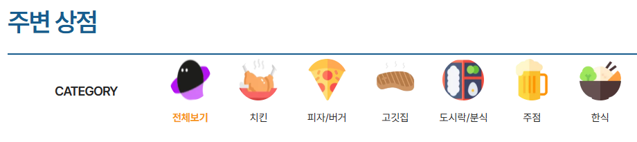
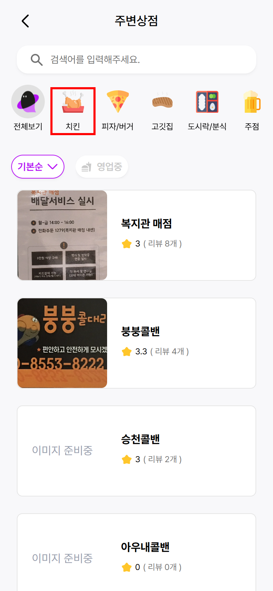

# 2-1 상점 카테고리 → 상점 카테고리 (클릭)

[← 주변상점 로깅 목록](README.md)

플랫폼: WEB · ANDROID · IOS  
원문 상태: 완료

과거 로깅·새 로깅과 각 참고사진은 원문의 구간별 연결을 유지합니다.

<!-- logging-section:past:start -->
## 과거 로깅

event\_params.key

- event\_label : shop\_categories

- value : \{카테고리\}    (들어간 카테고리)

- event\_category : click  

- previous\_page : \{이전 카테고리\}

- current\_page : \{현 카테고리\}

- duration\_time : 이전 카테고리에서 현 카테고리로 이동하는 시간 

### 오류 사항

웹: 

헤더나 푸터를 이용하여 들어온뒤 카테고리를 이동하면 scroll in 값이 뜨고 있습니다. 

---

IOS 

[해결 (1)](%ED%95%B4%EA%B2%B0-%281%29.md)

<!-- logging-section:past:end -->

<!-- logging-section:new:start -->
## 새 로깅

- 설명: 카테고리를 선택해서 주변 상점에 진입 후 또 다른 카테고리를 선택하는 경우
- screen\_view: <code>shop_list</code>
- event\_name: <code>DA1</code>
- event\_label: <code>shop__shop_list__filter__category__click</code>
- value: \{사용자가 클릭한 카테고리\} → 혜택 / 치킨 / 피자/버거 등 (예: 치킨)
- event\_category: <code>click</code>

### 참고사진 (카테고리 → 카테고리 클릭)

#### 웹

웹 — 상점 카테고리 이동 클릭 (출처: 기존 캡처)

#### 모바일

모바일 — 상점 카테고리 이동 클릭 (출처: stage 실제 캡처, 빨간 네모 = 클릭 위치)

<!-- logging-section:new:end -->

---

원문 정보

원본 ID: `17c0221954bc82578ec501af435d0b86`  
[보존 원문](../../_archive/original/notion/pages/17c0221954bc82578ec501af435d0b86.md)

