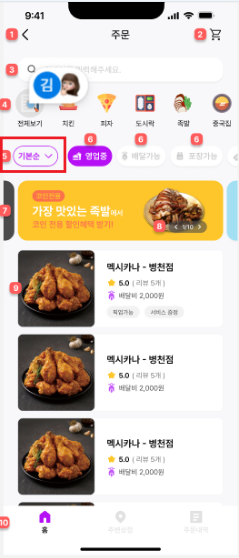
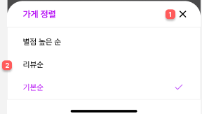
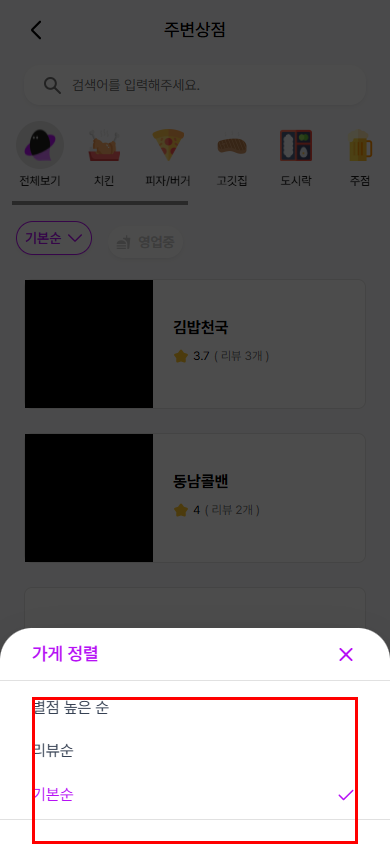

# 2-10~12 상점 카테고리 정렬

[← 주변상점 로깅 목록](README.md)

플랫폼: ANDROID · IOS · WEB (모바일)  
원문 상태: 로깅 필요

과거 로깅·새 로깅과 각 참고사진은 원문의 구간별 연결을 유지합니다.

<!-- logging-section:past:start -->
## 과거 로깅

기존 기능 및 디자인 → 로깅 수정 및 추가(오른쪽 사진)

event\_params.key

- event\_label : shop\_can

- value : 

- check\_delivery\_\{카테고리\}
- check\_review\_\{카테고리\}
- check\_star\_\{카테고리\}
- check\_open\_\{카테고리\}

- event\_category : click 

event\_params.key

- event\_label : shop\_can

- value : 

- check\_default\_\{카테고리\}
- check\_review\_\{카테고리\}
- check\_star\_\{카테고리\}

- event\_category : click 

---

메인화면이 아닌 주변상점 view의 경우에도 동일하게

로깅 심어주시면 됩니다 !

event\_params.key

- event\_label : shop\_can

- value : 

- check\_default\_\{카테고리\}
- check\_review\_\{카테고리\}
- check\_star\_\{카테고리\}

- event\_category : click 

<!-- logging-section:past:end -->

<!-- logging-section:new:start -->
## 새 로깅

- 설명: 상점 목록 화면에서 정렬 버튼(기본순)을 눌러 정렬 방식을 고르는 경우
- screen\_view: <code>shop_list</code>
- event\_name: <code>DA1</code>
- event\_label: <code>shop__shop_list__filter__sort__select</code>
- value: \{정렬\} → 기본순 / 리뷰순 / 별점 높은 순 (예: 리뷰순)
- event\_category: <code>select</code>

### 참고사진 (정렬 선택)

해당 없음 (PC 웹은 필터 체크박스 사용, 2-5\~8 참고)

#### 모바일

모바일 웹 · 2026-10-30 운영 /store?category=1 보라색 리디자인 실제 정렬 선택창. 빨간 테두리=별점 높은 순·리뷰순·기본순 선택 영역. 배경 썸네일의 연락처 가능 영역은 검은색 마스킹. 네이티브 앱과 SDK 발화는 미확인이다.

<!-- logging-section:new:end -->

---

원문 정보

원본 ID: `4510221954bc8352a9ee0164e9d7ce9d`  
[보존 원문](../../_archive/original/notion/pages/4510221954bc8352a9ee0164e9d7ce9d.md)

