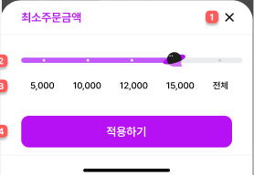

# 2-18 상점 카테고리 최소주문금액 설정 - 레거시

[← 주변상점 로깅 목록](README.md)

플랫폼: ANDROID · IOS  
원문 상태: 로깅 필요

과거 로깅·새 로깅과 각 참고사진은 원문의 구간별 연결을 유지합니다.

원문 미기재 항목: `event_name`, `screen_view`. 값을 추정하지 않았습니다.

<!-- logging-section:past:start -->
## 과거 로깅

금액을 설정하고 적용하기를 눌렀을 때 발생하는 로깅

event\_params.key

- event\_label : min\_amount\_set

- value : 금액

- event\_category : click 

<!-- logging-section:past:end -->

---

원문 정보

원본 ID: `adc0221954bc82aab20a818ad16b4d05`  
[보존 원문](../../_archive/original/notion/pages/adc0221954bc82aab20a818ad16b4d05.md)

