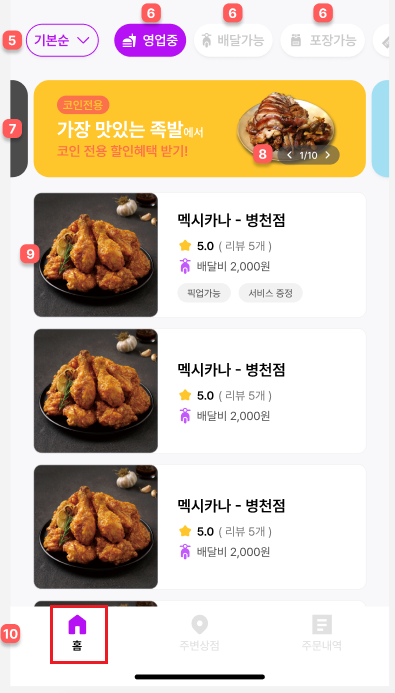

# [레거시] 2-19 상점 카테고리 → 홈 - 레거시

> **레거시 문서** · 과거 구현과 로깅을 확인하기 위한 보존 자료입니다.

[← 주변상점 로깅 목록](README.md)

플랫폼: ANDROID · IOS  
원문 상태: 로깅 필요

과거 로깅·새 로깅과 각 참고사진은 원문의 구간별 연결을 유지합니다.

원문 미기재 항목: `event_name`, `screen_view`. 값을 추정하지 않았습니다.

<!-- logging-section:past:start -->
## 과거 로깅

event\_params.key

- event\_label : shop\_categories\_home

- value :  \{카테고리\}

- event\_category : click 

- duration\_time : 이전 카테고리에서 현 카테고리로 이동하는 시간 

- previous\_page : \{이전 카테고리\}

- current\_page : \{현 카테고리\}

<!-- logging-section:past:end -->

---

원문 정보

원본 ID: `5000221954bc83628412014f70c3290f`  
[보존 원문](../../_archive/original/notion/pages/5000221954bc83628412014f70c3290f.md)

