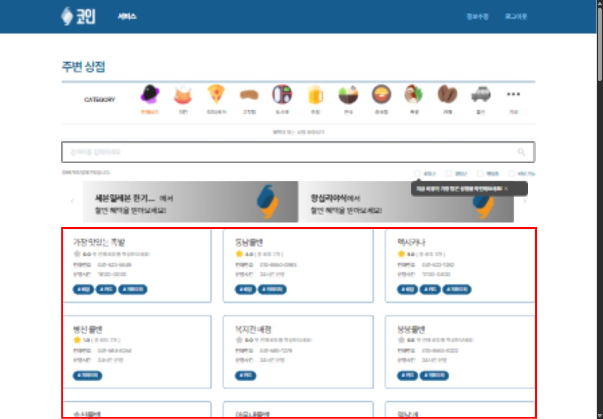
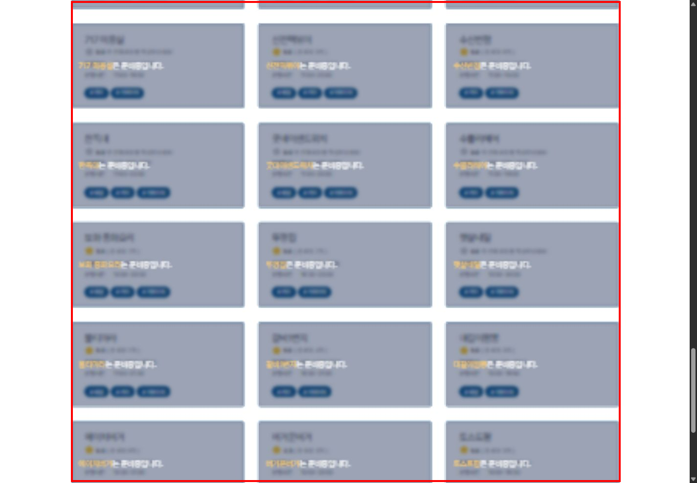

# 2-2 상점 카테고리 (스크롤)

[← 주변상점 로깅 목록](README.md)

플랫폼: WEB · ANDROID · IOS  
원문 상태: 완료

과거 로깅·새 로깅과 각 참고사진은 원문의 구간별 연결을 유지합니다.

<!-- logging-section:past:start -->
## 과거 로깅

event\_params.key

- event\_label : shop\_categories

- value : scroll in \{카테고리\}   

- event\_category : scroll

---

상점 카테고리에서  스크롤 횟수를 파악하고자 하는 이벤트 입니다. 

---

### 오류사항

웹: 

전체보기에서 스크롤이 안되는 상황 

---

[해결 (1)](%ED%95%B4%EA%B2%B0-%281%29-e7b02219.md)

<!-- logging-section:past:end -->

<!-- logging-section:new:start -->
## 새 로깅

- 설명: 상점 목록 화면에서 상점 목록을 스크롤하는 경우 (스크롤 횟수 파악용)
- screen\_view: <code>shop_list</code>
- event\_name: <code>DA1</code>
- event\_label: <code>shop__shop_list__shop_list__scroll</code>
- value: \{현재 카테고리\} → 전체보기 / 치킨 / 피자/버거 등 (예: 전체보기)
- event\_category: <code>scroll</code>

### 참고사진 (상점 목록 스크롤)

<b>웹</b>

<b>스크롤 전후 · 운영 WEB (2026-10-30)</b>

출처: [koreatech.in](http://koreatech.in) 실제 주변상점 목록 화면. 빨간 테두리=목록 영역. 실제 스크롤 후 화면 위치를 비교하는 참고자료이며 SDK 이벤트 대상·발화·중복 전송은 미확인이다.

WEB · 스크롤 전 · 2026-10-30.

WEB · 스크롤 후 · 2026-10-30.

<b>모바일</b>

<b>참고사진 · 모바일</b>

<!-- logging-section:new:end -->

---

원문 정보

원본 ID: `69b0221954bc83c3b2b38115cc09c0bf`  
[보존 원문](../../_archive/original/notion/pages/69b0221954bc83c3b2b38115cc09c0bf.md)

