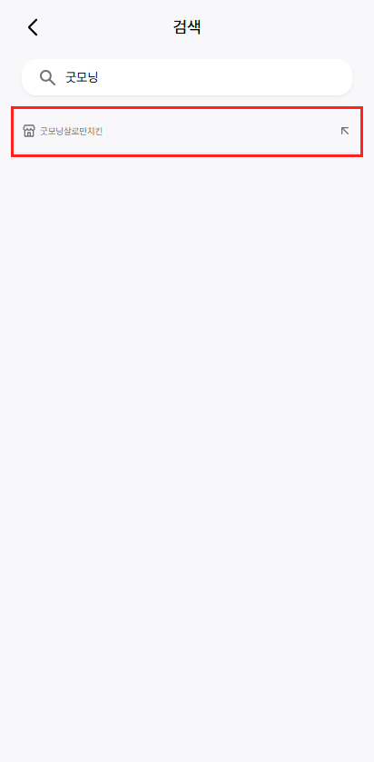

# 2-22 검색 결과 → 상점 상세 (클릭)

[← 주변상점 로깅 목록](README.md)

플랫폼: IOS · ANDROID  
원문 상태: 로깅 필요

과거 로깅·새 로깅과 각 참고사진은 원문의 구간별 연결을 유지합니다.

<!-- logging-section:past:start -->
## 과거 로깅

- event\_label: <code>shop_categories_search_click</code>
- value: \{상점이름\}
- event\_category: click

<!-- logging-section:past:end -->

<!-- logging-section:new:start -->
## 새 로깅

- 설명: 상점 검색 결과에서 상점을 선택해 해당 상점 상세 화면으로 진입할 때 기록한다.
- screen\_view: <code>shop_search</code>
- event\_name: <code>DA1</code>
- event\_label: <code>shop__shop_search__shop_detail__entry__click</code>
- value: \{상점이름\}
- event\_category: <code>click</code>

### 참고사진

<b>웹</b>

Stage PC 웹 · 검색 결과 행 선택

<b>모바일</b>

Stage 모바일 웹 · 검색 결과 행 선택

<!-- logging-section:new:end -->

---

원문 정보

원본 ID: `4990221954bc82568e8881f0ce310b9e`  
[보존 원문](../../_archive/original/notion/pages/4990221954bc82568e8881f0ce310b9e.md)

