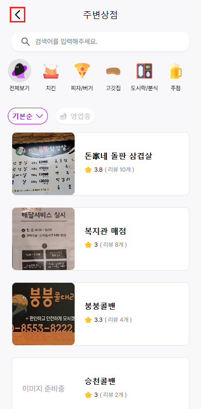

# 2-23 상점 목록 뒤로가기 (Click · Swipe)

[← 주변상점 로깅 목록](README.md)

플랫폼: IOS · ANDROID  
원문 상태: 로깅 필요

과거 로깅·새 로깅과 각 참고사진은 원문의 구간별 연결을 유지합니다.

<!-- logging-section:past:start -->
## 과거 로깅

- event\_label: <code>shop_categories_back</code>
- value: 기존 명세 미기재
- event\_category: click / swipe

<!-- logging-section:past:end -->

<!-- logging-section:new:start -->
## 새 로깅

### 뒤로가기 버튼

- 설명: 상점 목록에서 뒤로가기 버튼 또는 뒤로가기 스와이프로 이전 화면으로 돌아가는 전환이 완료되었을 때 기록한다. 취소된 스와이프와 하단 홈 탭 클릭은 포함하지 않는다.
- screen\_view: <code>shop_list</code>
- event\_name: <code>DA1</code>
- event\_label: <code>shop__shop_list__navigation__back__click</code>
- value: 메인
- event\_category: <code>click</code>

### 뒤로가기 스와이프

- 설명: 상점 목록에서 뒤로가기 버튼 또는 뒤로가기 스와이프로 이전 화면으로 돌아가는 전환이 완료되었을 때 기록한다. 취소된 스와이프와 하단 홈 탭 클릭은 포함하지 않는다.
- screen\_view: <code>shop_list</code>
- event\_name: <code>DA1</code>
- event\_label: <code>shop__shop_list__navigation__back__swipe</code>
- value: 메인
- event\_category: <code>swipe</code>

### 참고사진

<b>웹</b>

PC 웹: 상점 목록에 대응하는 뒤로가기 버튼 없음.

<b>모바일</b>

Stage 모바일 웹 · 상점 목록 뒤로가기 버튼

<!-- logging-section:new:end -->

---

원문 정보

원본 ID: `ff80221954bc83ae983c01e2a49554a9`  
[보존 원문](../../_archive/original/notion/pages/ff80221954bc83ae983c01e2a49554a9.md)

