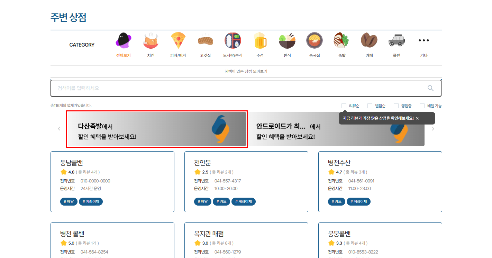

# 2-3 상점카테고리 이벤트 (클릭) 

[← 주변상점 목록](README.md)

플랫폼: WEB, ANDROID, IOS  
원문 상태: 완료  
[Notion 기준 명세](https://app.notion.com/p/d090221954bc820591078118a46a040c)  
원본 ID: `d090221954bc820591078118a46a040c`

<!-- notion-body:start -->
## 과거 로깅

event\_params.key

- event\_label : shop\_categories\_event
- value : \{가게이름\}
- event\_category : click

## 새 로깅

- 설명: 상점 목록 화면에서 이벤트 중인 가게(이벤트 배너/표시)를 클릭하는 경우
- screen\_view: <code>shop_list</code>
- event\_name: <code>DA1</code>
- event\_label: <code>shop__shop_list__shop_event__entry__click</code>
- value: \{가게이름\} (예: 복지관 매점)
- event\_category: <code>click</code>

### 참고사진 (이벤트 가게 클릭)

<b>웹</b>

<b>참고사진 · 웹</b>

웹 — 상점 목록 이벤트 가게 클릭 (출처: stage 실제 캡처, 빨간 네모 = 클릭 위치)




<b>모바일</b>

<b>참고사진 · 모바일</b>

없음
<!-- notion-body:end -->

<details>
<summary>Notion 원문 속성 전체</summary>

```json
{
  "platform": [
    "WEB",
    "ANDROID",
    "IOS"
  ],
  "url": "https://app.notion.com/p/d090221954bc820591078118a46a040c",
  "상태": "완료",
  "생성일": "2026-11-23T13:38:20.581Z",
  "이벤트 이름": "2-3 상점카테고리 이벤트 (클릭) ",
  "태그": [
    "2. 상점 카테고리"
  ]
}
```

</details>
