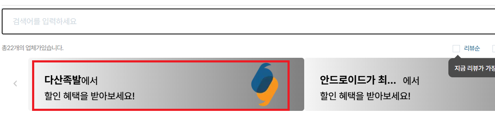

# 2-3 상점카테고리 이벤트 (클릭)

[← 주변상점 로깅 목록](README.md)

플랫폼: WEB · ANDROID · IOS  
원문 상태: 완료

과거 로깅·새 로깅과 각 참고사진은 원문의 구간별 연결을 유지합니다.

<!-- logging-section:past:start -->
## 과거 로깅

event\_params.key

- event\_label : shop\_categories\_event

- value : \{가게이름\}

- event\_category : click 

<!-- logging-section:past:end -->

<!-- logging-section:new:start -->
## 새 로깅

- 설명: 상점 목록 화면에서 이벤트 중인 가게(이벤트 배너/표시)를 클릭하는 경우
- screen\_view: <code>shop_list</code>
- event\_name: <code>DA1</code>
- event\_label: <code>shop__shop_list__shop_event__entry__click</code>
- value: \{가게이름\} (예: 복지관 매점)
- event\_category: <code>click</code>

### 참고사진 (이벤트 가게 클릭)

#### 웹

웹 — 상점 목록 이벤트 가게 클릭 (출처: stage 실제 캡처, 빨간 네모 = 클릭 위치)

없음

<!-- logging-section:new:end -->

---

원문 정보

원본 ID: `c280221954bc822b81ed81eca5996597`  
[보존 원문](../../_archive/original/notion/pages/c280221954bc822b81ed81eca5996597.md)

