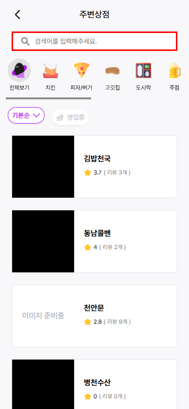

# 2-4 상점카테고리 검색 (클릭)

[← 주변상점 로깅 목록](README.md)

플랫폼: WEB · ANDROID · IOS  
원문 상태: 완료

과거 로깅·새 로깅과 각 참고사진은 원문의 구간별 연결을 유지합니다.

<!-- logging-section:past:start -->
## 과거 로깅

event\_params.key

- event\_label : shop\_categories\_search

- value : search in \{카테고리\}

- event\_category : click 

---

이후 검색이 통합될 경우 다시 만져야함. 

---

### 오류사항

[해결 (1)](%ED%95%B4%EA%B2%B0-%281%29-5c502219.md)

<!-- logging-section:past:end -->

<!-- logging-section:new:start -->
## 새 로깅

- 설명: 상점 목록 화면에서 주변상점 카테고리를 선정하고 검색 창으로 들어가는 경우
- screen\_view: <code>shop_list</code>
- event\_name: <code>DA1</code>
- event\_label: <code>shop__shop_list__search__click</code>
- value: \{현재 카테고리\} → 전체보기 / 치킨 / 피자/버거 등 (예: 치킨)
- event\_category: <code>click</code>

### 참고사진 (검색 창 진입)

#### 웹

WEB · stage 실제 검색창 진입. 빨간 테두리=명세 대상. 콘솔 없음. 2026-10-30.

#### 모바일

모바일 웹 · 2026-10-30 운영 보라색 주변상점 목록. 빨간 테두리=검색 화면으로 진입하는 검색 버튼. 썸네일의 연락처 가능 영역은 검은색 마스킹. 네이티브 앱·SDK 발화는 미확인이다.

<!-- logging-section:new:end -->

---

원문 정보

원본 ID: `5eb0221954bc832db46281e732909fd6`  
[보존 원문](../../_archive/original/notion/pages/5eb0221954bc832db46281e732909fd6.md)

