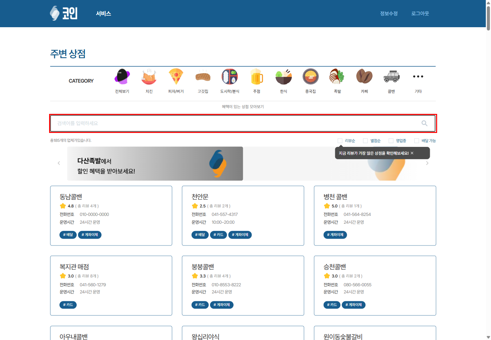

# 2-4 상점카테고리 검색 (클릭) 

[← 주변상점 목록](README.md)

플랫폼: WEB, ANDROID, IOS  
원문 상태: 완료  
[Notion 기준 명세](https://app.notion.com/p/2d90221954bc82c1bd0d0158452708c6)  
원본 ID: `2d90221954bc82c1bd0d0158452708c6`

<!-- notion-body:start -->
## 과거 로깅

event\_params.key

- event\_label : shop\_categories\_search
- value : search in \{카테고리\}
- event\_category : click

---

이후 검색이 통합될 경우 다시 만져야함. 

---

### 오류사항

[해결 (1)](https://app.notion.com/p/82d0221954bc828db13081821c421e0c)

## 새 로깅

- 설명: 상점 목록 화면에서 주변상점 카테고리를 선정하고 검색 창으로 들어가는 경우
- screen\_view: <code>shop_list</code>
- event\_name: <code>DA1</code>
- event\_label: <code>shop__shop_list__search__click</code>
- value: \{현재 카테고리\} → 전체보기 / 치킨 / 피자/버거 등 (예: 치킨)
- event\_category: <code>click</code>

### 참고사진 (검색 창 진입)

<b>웹</b>

<b>참고사진 · 웹</b>


WEB · stage 실제 검색창 진입. 빨간 테두리=명세 대상. 콘솔 없음. 2026-10-30.

<b>모바일</b>

<b>참고사진 · 모바일</b>


모바일 웹 · 2026-10-30 운영 보라색 주변상점 목록. 빨간 테두리=검색 화면으로 진입하는 검색 버튼. 썸네일의 연락처 가능 영역은 검은색 마스킹. 네이티브 앱·SDK 발화는 미확인이다.
<!-- notion-body:end -->

<details>
<summary>Notion 원문 속성 전체</summary>

```json
{
  "platform": [
    "WEB",
    "ANDROID",
    "IOS"
  ],
  "url": "https://app.notion.com/p/2d90221954bc82c1bd0d0158452708c6",
  "상태": "완료",
  "생성일": "2026-11-23T13:38:15.805Z",
  "이벤트 이름": "2-4 상점카테고리 검색 (클릭) ",
  "태그": [
    "2. 상점 카테고리"
  ]
}
```

</details>
