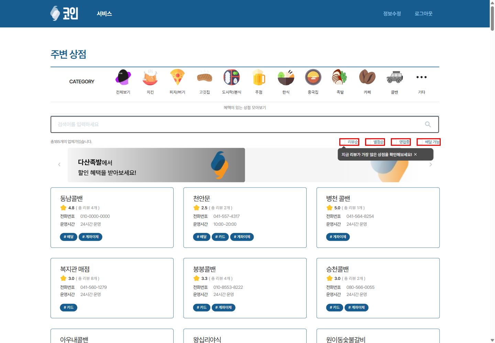

# 2-5~8 상점 카테고리 토글 

[← 주변상점 목록](README.md)

플랫폼: WEB, ANDROID, IOS  
원문 상태: 완료  
[Notion 기준 명세](https://app.notion.com/p/1de0221954bc82a283ab0113f045affa)  
원본 ID: `1de0221954bc82a283ab0113f045affa`

<!-- notion-body:start -->
## 과거 로깅

event\_params.key

- event\_label : shop\_can
- value :

  - check\_delivery\_\{카테고리\}
  - check\_review\_\{카테고리\}
  - check\_star\_\{카테고리\}
  - check\_open\_\{카테고리\}
- event\_category : click

---

상점카테고리에서 토글을 클릭하는 횟수를 파악하고자 하는 이벤트 입니다.

현재 웹만 존재하는 상황. 

→ 체크 되었을때만 이벤트를 카운트 해주시면 됩니다. 

---

### 오류 사항

[해결 (1)](https://app.notion.com/p/9620221954bc821d96770147757a0471)

## 새 로깅

- 설명: 상점 목록 화면에서 배달·리뷰·별점·영업중 체크박스가 해제 상태에서 선택 상태로 바뀔 때 1회 기록한다. 선택 해제에는 기록하지 않는다.
- screen\_view: <code>shop_list</code>
- event\_name: <code>DA1</code>
- event\_label: <code>shop__shop_list__filter__checkbox__select</code>
- value: \{켠 필터\} → 배달 / 리뷰 / 별점 / 영업중 (예: 영업중)
- event\_category: <code>select</code>

### 참고사진 (상점 목록 필터 체크)

<b>웹</b>

<b>참고사진 · 웹</b>


WEB · stage 실제 리뷰순·별점순·영업중·배달 가능 체크박스. 빨간 테두리=필터들. 2026-10-30.

<b>모바일</b>

<b>참고사진 · 모바일</b>

없음
<!-- notion-body:end -->

<details>
<summary>Notion 원문 속성 전체</summary>

```json
{
  "platform": [
    "WEB",
    "ANDROID",
    "IOS"
  ],
  "url": "https://app.notion.com/p/1de0221954bc82a283ab0113f045affa",
  "상태": "완료",
  "생성일": "2026-11-23T13:38:19.439Z",
  "이벤트 이름": "2-5\\~8 상점 카테고리 토글 ",
  "태그": [
    "2. 상점 카테고리"
  ]
}
```

</details>
