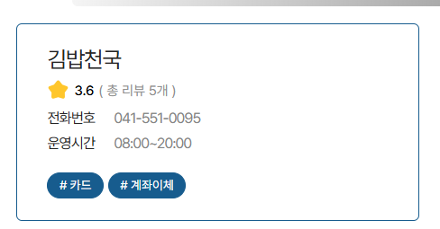
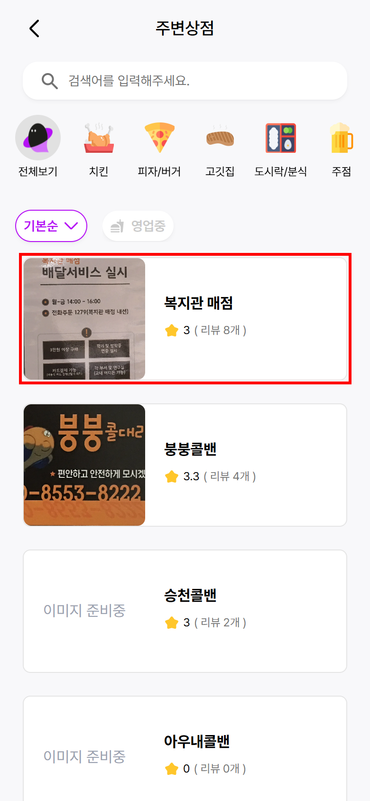

# 3-1 상점 카테고리 → 상점상세 (클릭)

[← 주변상점 로깅 목록](README.md)

플랫폼: WEB · ANDROID · IOS  
원문 상태: 완료

과거 로깅·새 로깅과 각 참고사진은 원문의 구간별 연결을 유지합니다.

<!-- logging-section:past:start -->
## 과거 로깅

event\_params.key

- event\_label : shop\_click

- value : \{상점이름\} 

- event\_category : click 

- previous\_page : \{카테고리\}

- current\_page : \{상점이름\}

- duration\_time : 상점 카테고리에서 상점상세 페이지로 들어간 시간(ms) 

---

상점카테고리에서 상점 상세 페이지로 들어가는 시간을 파악하고자 합니다. 

검색을 해서 이동하는 경우도 포함하여 시간을 계산합니다.  

---

### 오류 사항

[해결 (1)](%ED%95%B4%EA%B2%B0-%281%29-0b602219.md)

<!-- logging-section:past:end -->

<!-- logging-section:new:start -->
## 새 로깅

- 설명: 상점 목록 화면에서 가게를 클릭해 상점 상세 화면으로 들어가는 경우
- screen\_view: <code>shop_list</code>
- event\_name: <code>DA1</code>
- event\_label: <code>shop__shop_list__shop_detail__entry__click</code>
- value: \{상점이름\} → ex) OO치킨, OO피자 등등 (예: 복지관 매점)
- event\_category: <code>click</code>

### 참고사진 (상점 카드 클릭)

<b>웹</b>

<b>참고사진 · 웹</b>

웹 — 상점 카드 클릭 (출처: 기존 캡처)

<b>모바일</b>

<b>참고사진 · 모바일</b>

모바일 — 상점 카드 클릭 (출처: stage 실제 캡처, 빨간 네모 = 클릭 위치)

<!-- logging-section:new:end -->

---

원문 정보

원본 ID: `d980221954bc82c08f6181ac1ce34184`  
[보존 원문](../../_archive/original/notion/pages/d980221954bc82c08f6181ac1ce34184.md)

