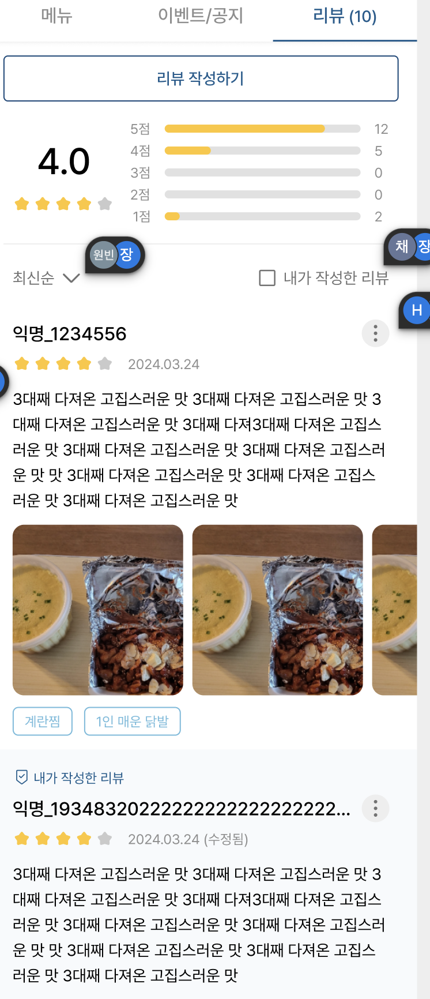
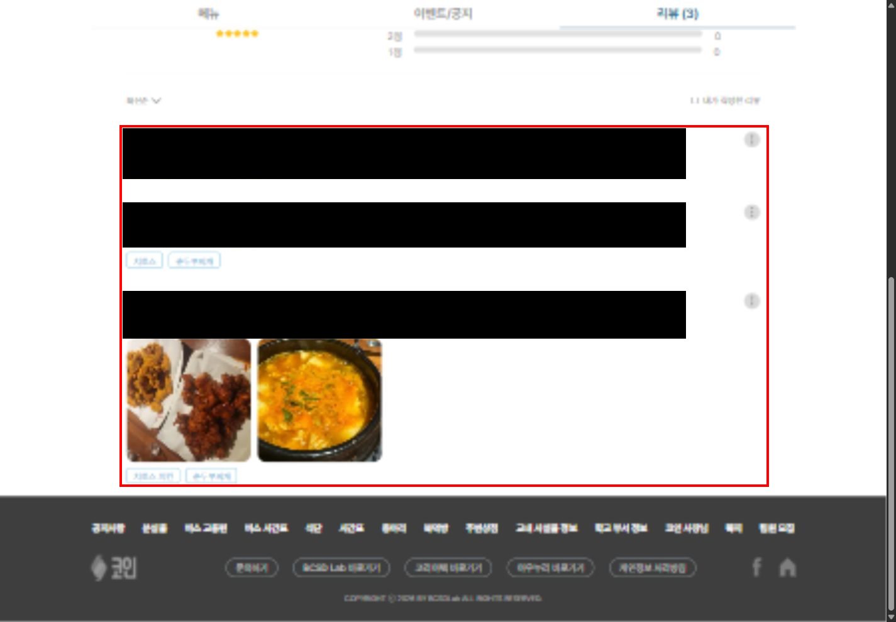
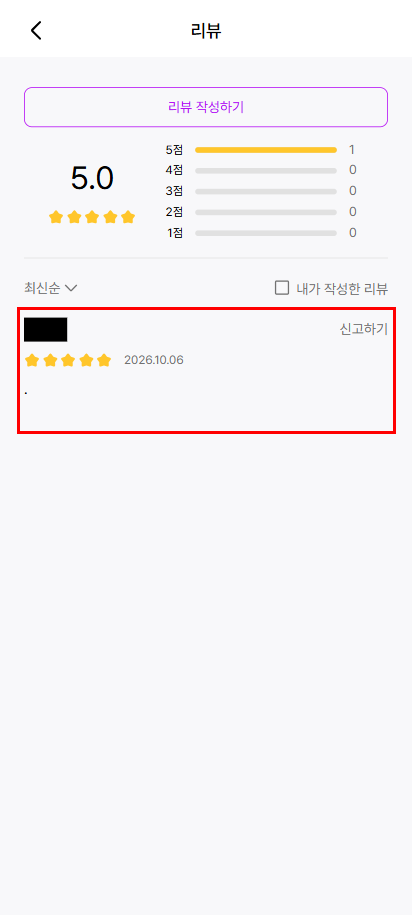

# 3-11 상점상세 리뷰 (스크롤)

[← 주변상점 로깅 목록](README.md)

플랫폼: WEB · ANDROID · IOS  
원문 상태: 완료

과거 로깅·새 로깅과 각 참고사진은 원문의 구간별 연결을 유지합니다.

<!-- logging-section:past:start -->
## 과거 로깅

event\_params.key

- event\_label : shop\_detail\_view\_review

- value : \{상점이름\} 

- event\_category : scroll

---

<!-- logging-section:past:end -->

<!-- logging-section:new:start -->
## 새 로깅

- 설명: 상점 상세 화면의 리뷰 탭에서 리뷰 목록을 스크롤하는 경우
- screen\_view: <code>shop_detail</code>
- event\_name: <code>DA1</code>
- event\_label: <code>shop__shop_detail__shop_review__scroll</code>
- value: \{상점이름\} (예: 복지관 매점)
- event\_category: <code>scroll</code>

### 참고사진 (리뷰 목록 스크롤)

<b>웹</b>

<b>리뷰 목록 · 운영 WEB (2026-10-30)</b>

WEB · 2026-10-30 운영 주변상점 리뷰 3건 목록. 닉네임·본문은 검은색 마스킹. 빨간 테두리=리뷰 목록 영역. 스크롤 이동을 확인한 화면 참고자료이며 SDK 수집·한 번 전송은 미확인이다.

<b>모바일</b>

<b>참고사진 · 모바일</b>

모바일 웹 · 운영 왕십리야식 보라색 리디자인 리뷰 목록. 동일 실제 리뷰 촬영 프레임을 재사용해 빨간 테두리로 목록 위치를 표시했다. 현재 리뷰 1개이며 스크롤 발화 검증과 구분. 닉네임 검은색 마스킹.

구버전 모바일 사진을 제거하고 현행 보라색 모바일 웹 사진으로 보완했다.

<!-- logging-section:new:end -->

---

원문 정보

원본 ID: `cc70221954bc8339b46d01bcbc6e9b70`  
[보존 원문](../../_archive/original/notion/pages/cc70221954bc8339b46d01bcbc6e9b70.md)

