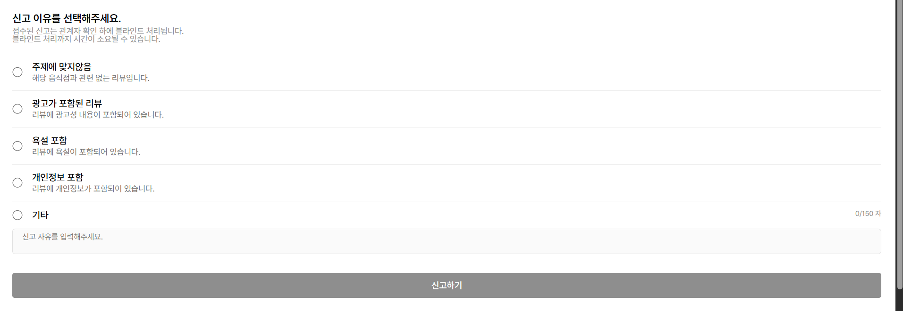
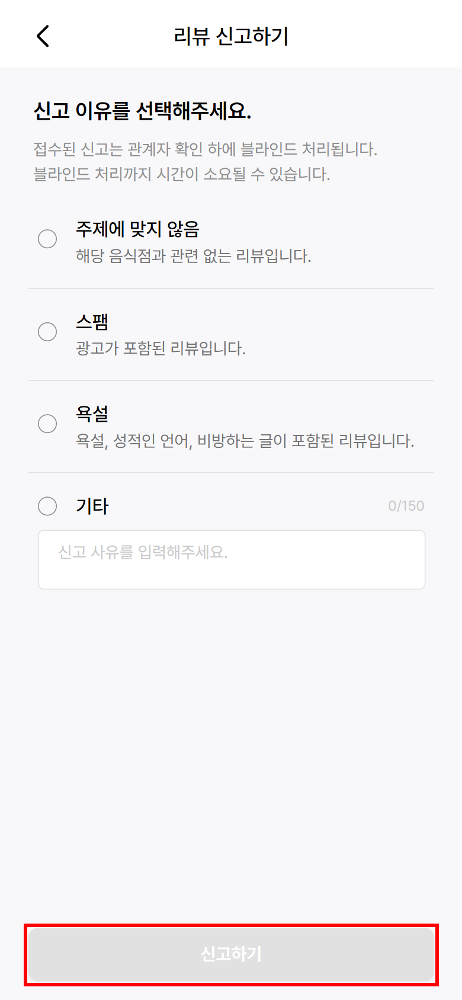

# 3-15 상점상세 리뷰 신고 완료 (클릭)

[← 주변상점 로깅 목록](README.md)

플랫폼: WEB · ANDROID · IOS  
원문 상태: 완료

과거 로깅·새 로깅과 각 참고사진은 원문의 구간별 연결을 유지합니다.

<!-- logging-section:past:start -->
## 과거 로깅

event\_params.key

- event\_label : shop\_detail\_view\_review\_report\_done

- value : \{상점이름\} 

- event\_category : click

---

신고하기 완료 버튼을 누르는 행위 입니다. 

<!-- logging-section:past:end -->

<!-- logging-section:new:start -->
## 새 로깅

- 설명: 리뷰 신고 화면에서 신고하기(완료) 버튼을 클릭하는 경우
- screen\_view: <code>shop_detail</code>
- event\_name: <code>DA1</code>
- event\_label: <code>shop__shop_detail__review_report__confirm__click</code>
- value: \{상점이름\} (예: 복지관 매점)
- event\_category: <code>click</code>

### 참고사진 (리뷰 신고 완료)

<b>웹</b>

<b>참고사진 · 웹</b>

웹 — 신고하기 버튼 클릭 시 (출처: 기존 캡처)

<b>모바일</b>

<b>참고사진 · 모바일</b>

모바일 — 신고하기 버튼 클릭 (출처: stage 실제 캡처, 빨간 네모 = 클릭 위치)

<!-- logging-section:new:end -->

---

원문 정보

원본 ID: `89a0221954bc8268a6cf81d4c3d85b02`  
[보존 원문](../../_archive/original/notion/pages/89a0221954bc8268a6cf81d4c3d85b02.md)

