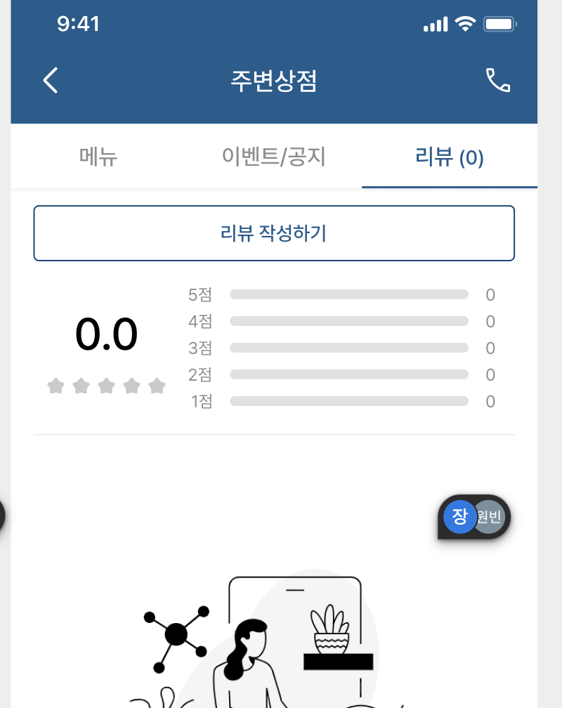
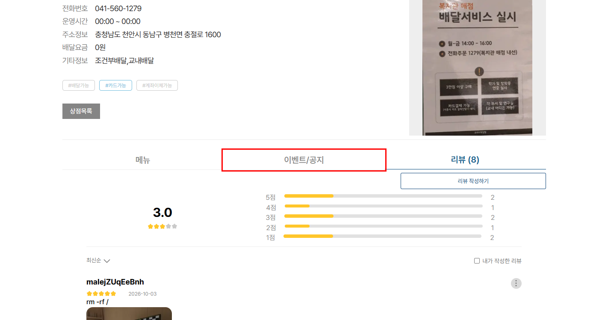
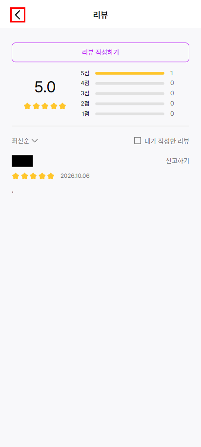

# 3-16~18 상점상세 리뷰 탭 탈출 (클릭) 

[← 주변상점 목록](README.md)

플랫폼: WEB, ANDROID, IOS  
원문 상태: 완료  
[Notion 기준 명세](https://app.notion.com/p/1450221954bc8372b5ee816ce4dc92e4)  
원본 ID: `1450221954bc8372b5ee816ce4dc92e4`

<!-- notion-body:start -->
## 과거 로깅

event\_params.key

- event\_label : shop\_detail\_view\_review\_back
- value : \{상점이름\}
- event\_category :

  - click
  - click
  - click<br />
- previous\_page : 리뷰
- current\_page :

    - \{탭\} (메뉴, 이벤트/공지)
    - 전화
    - \{카테고리\}
- duration\_time : 리뷰페이지에서 머무르는 시간



---

### 문제

ios : 시간이 겹쳐서 찍히고 있는시점. 

## 새 로깅

- <b>설명:</b> 리뷰 화면 또는 리뷰 영역에서 버튼 클릭이나 iOS 뒤로가기 스와이프로 실제 이동했을 때 리뷰 이탈을 1회 기록한다. 독립 리뷰 화면에서는 뒤로가기 후 복귀한 화면을 기준으로 하며, 현재 UI에 없는 탭 전환은 포함하지 않는다. 취소된 스와이프는 기록하지 않는다.
- screen\_view: <code>shop_detail</code>
- event\_name: <code>DA1</code>
- event\_label: <code>shop__shop_detail__navigation__review_exit__click / shop__shop_detail__navigation__review_exit__swipe (iOS만 해당)</code>
- value: 뒤로가기 / 스와이프
- event\_category: <code>click / swipe (iOS만 해당)</code>

### 참고사진 (리뷰 탭 이탈)

<b>웹</b>

<b>참고사진 · 웹</b>

웹 — 리뷰 탭에서 이벤트/공지로 이동 예시 (출처: stage 실제 캡처, 빨간 네모 = 클릭 위치)



<b>모바일</b>

<b>참고사진 · 모바일</b>


모바일 웹 · 운영 왕십리야식 보라색 리디자인 리뷰 화면. 빨간 테두리=뒤로가기. 현행 UI는 독립 리뷰 화면이며 과거 탭 전환 UI와 구분한다. 닉네임 검은색 마스킹.

구버전 모바일 사진을 제거하고 현행 보라색 모바일 웹 사진으로 보완했다.
<!-- notion-body:end -->

<details>
<summary>Notion 원문 속성 전체</summary>

```json
{
  "platform": [
    "WEB",
    "ANDROID",
    "IOS"
  ],
  "url": "https://app.notion.com/p/1450221954bc8372b5ee816ce4dc92e4",
  "상태": "완료",
  "생성일": "2026-11-23T13:38:18.456Z",
  "이벤트 이름": "3-16\\~18 상점상세 리뷰 탭 탈출 (클릭) ",
  "태그": [
    "3. 상점 상세 페이지"
  ]
}
```

</details>
