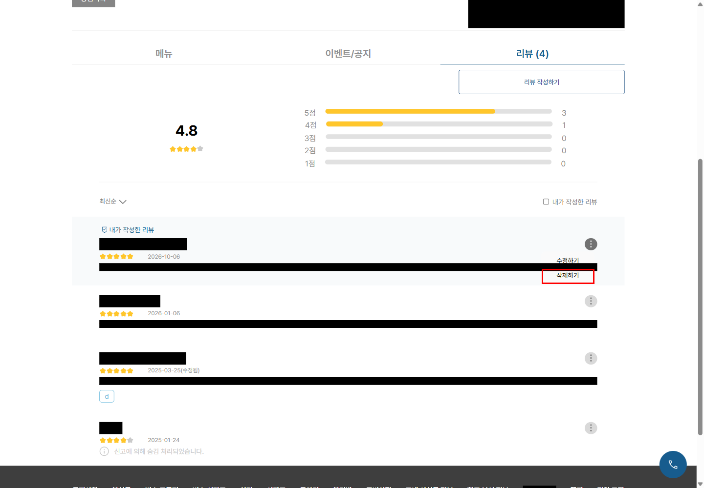
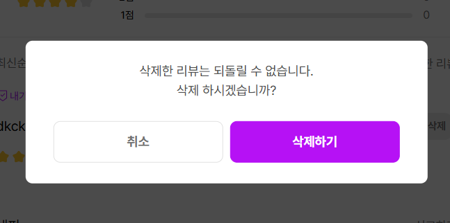

# 3-19 상점상세 리뷰 삭제하기 (클릭)

[← 주변상점 로깅 목록](README.md)

플랫폼: WEB · ANDROID · IOS  
원문 상태: 완료

과거 로깅·새 로깅과 각 참고사진은 원문의 구간별 연결을 유지합니다.

<!-- logging-section:past:start -->
## 과거 로깅

event\_params.key

- event\_label : shop\_detail\_view\_review\_delete

- value : \{상점이름\} 

- event\_category : click

<!-- logging-section:past:end -->

<!-- logging-section:new:start -->
## 새 로깅

- 설명: 상점 상세 화면(리뷰 탭)에서 내가 쓴 리뷰의 삭제 버튼을 클릭하는 경우
- screen\_view: <code>shop_detail</code>
- event\_name: <code>DA1</code>
- event\_label: <code>shop__shop_detail__review_delete__open__click</code>
- value: \{상점이름\} (예: 복지관 매점)
- event\_category: <code>click</code>

### 참고사진 (리뷰 삭제 버튼)

<b>웹</b>

<b>참고사진 · 웹</b>

WEB · stage 실제 내 리뷰의 삭제하기 버튼. 빨간 테두리는 삭제 확인창을 열기 전 진입 버튼이다. 닉네임·리뷰 본문·연락처가 포함될 수 있는 영역은 검은색 마스킹. 실제 삭제는 수행하지 않았다.

<b>모바일</b>

<b>참고사진 · 모바일</b>

모바일 — 보조자료: 삭제 확인창이 열린 이후의 기존 화면. 이 사진은 3-19의 삭제 버튼 클릭 위치를 보여주지 않는다. 삭제 버튼이 보이는 앱 대표사진은 추가 필요하며 최종 삭제 단계(3-20)와 구분한다.

<!-- logging-section:new:end -->

---

원문 정보

원본 ID: `dad0221954bc829bbc31817e634dcb52`  
[보존 원문](../../_archive/original/notion/pages/dad0221954bc829bbc31817e634dcb52.md)

