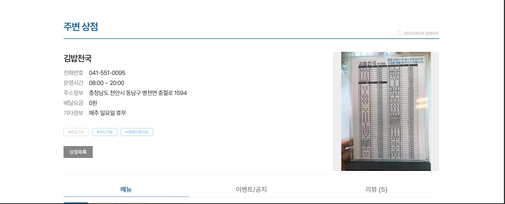
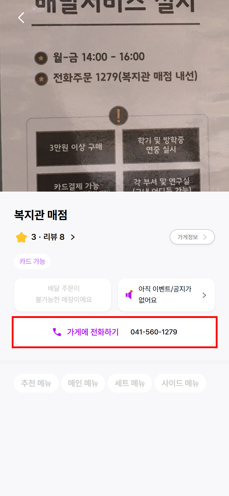

# 3-2 상점상세 전화 (클릭) 

[← 주변상점 목록](README.md)

플랫폼: WEB, ANDROID, IOS  
원문 상태: 완료  
[Notion 기준 명세](https://app.notion.com/p/fc80221954bc83c3b7ef819c98fc6913)  
원본 ID: `fc80221954bc83c3b7ef819c98fc6913`

<!-- notion-body:start -->
## 과거 로깅

event\_params.key

- event\_label : shop\_call
- value : \{상점이름\}
- event\_category : click

- duration\_time : 상점 상세페이지로 들어와서 전화를 하기까지 걸린시간.

---

시간 측정시 주의 사항 : 

- 상점 상세페이지에서 어떤 행위를 하던 상관 없음. (스크롤, 사진누르기 등)
- 첫번째 전화후 두번째 전화는 어떻게 측정하나요? <br />→ 두번째 전화도 상점 상세페이지 부터 전화 버튼 누른 시간까지 측정하면 됩니다.

---

### 오류사항

---

안드로이드 

- 로그인 찍히는 이슈

[해결 (1)](https://app.notion.com/p/5170221954bc82808ffb81b81fbd7cf9)

## 새 로깅

- 설명: 상점 상세 화면에서 전화 버튼을 클릭하는 경우
- screen\_view: <code>shop_detail</code>
- event\_name: <code>DA1</code>
- event\_label: <code>shop__shop_detail__contact__phone__click</code>
- value: \{상점이름\} → ex) OO치킨, OO피자 등등 (예: 복지관 매점)
- event\_category: <code>click</code>

### 참고사진 (전화 버튼 클릭)

<b>웹</b>

<b>참고사진 · 웹</b>

웹 — 전화 버튼 클릭 (출처: 기존 캡처)



<b>모바일</b>

<b>참고사진 · 모바일</b>

모바일 — 전화 버튼 클릭 (출처: stage 실제 캡처, 빨간 네모 = 클릭 위치)


<!-- notion-body:end -->

<details>
<summary>Notion 원문 속성 전체</summary>

```json
{
  "platform": [
    "WEB",
    "ANDROID",
    "IOS"
  ],
  "url": "https://app.notion.com/p/fc80221954bc83c3b7ef819c98fc6913",
  "상태": "완료",
  "생성일": "2026-11-23T13:38:18.570Z",
  "이벤트 이름": "3-2 상점상세 전화 (클릭) ",
  "태그": [
    "3. 상점 상세 페이지"
  ]
}
```

</details>
