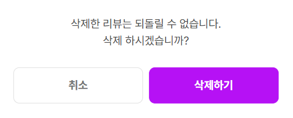
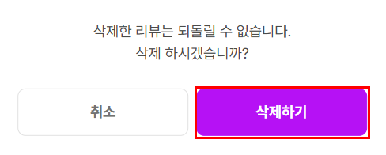

# 3-20 상점상세 리뷰 최종삭제하기  (클릭) 

[← 주변상점 목록](README.md)

플랫폼: WEB, ANDROID, IOS  
원문 상태: 완료  
[Notion 기준 명세](https://app.notion.com/p/8190221954bc83d1b3b581b343ecd740)  
원본 ID: `8190221954bc83d1b3b581b343ecd740`

<!-- notion-body:start -->
## 과거 로깅

event\_params.key

- event\_label : shop\_detail\_view\_review\_delete\_done
- value : \{상점이름\}
- event\_category : click

## 새 로깅

- 설명: 리뷰 삭제 확인 팝업에서 최종 삭제 버튼을 클릭하는 경우
- screen\_view: <code>shop_detail</code>
- event\_name: <code>DA1</code>
- event\_label: <code>shop__shop_detail__review_delete__confirm__click</code>
- value: \{상점이름\} (예: 복지관 매점)
- event\_category: <code>click</code>

### 참고사진 (리뷰 최종 삭제)

<b>웹</b>

<b>참고사진 · 웹</b>

웹 — 최종 삭제 버튼 클릭 (출처: stage 실제 캡처, 빨간 네모 = 클릭 위치)


기존 캡처 (플랫폼 구분 없음)




<b>모바일</b>

<b>참고사진 · 모바일</b>

출처: [3-21 상점상세 리뷰 삭제하기_취소 (클릭)](https://app.notion.com/p/af80221954bc82cd81e68189f364c181)의 모바일 참고사진으로 분류된 기존 삭제 확인창 사본. 빨간 네모 = 최종 삭제하기 버튼. 원본은 잘린 팝업 이미지(488x196)이므로 실제 플랫폼과 현행 모바일 화면은 미확인이다. 현행 stage에서 최종 삭제를 실행하거나 새로 캡처한 이미지가 아니다.


<!-- notion-body:end -->

<details>
<summary>Notion 원문 속성 전체</summary>

```json
{
  "platform": [
    "WEB",
    "ANDROID",
    "IOS"
  ],
  "url": "https://app.notion.com/p/8190221954bc83d1b3b581b343ecd740",
  "상태": "완료",
  "생성일": "2026-11-23T13:38:16.053Z",
  "이벤트 이름": "3-20 상점상세 리뷰 최종삭제하기  (클릭) ",
  "태그": [
    "3. 상점 상세 페이지"
  ]
}
```

</details>
