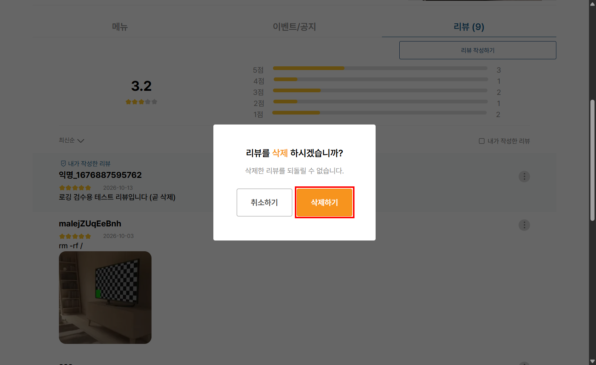
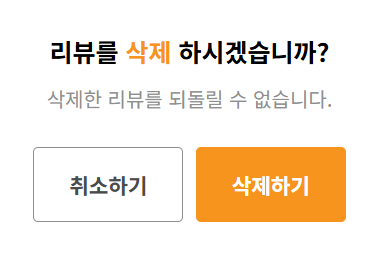

# 3-20 상점상세 리뷰 최종삭제하기 (클릭)

[← 주변상점 로깅 목록](README.md)

플랫폼: WEB · ANDROID · IOS  
원문 상태: 완료

과거 로깅·새 로깅과 각 참고사진은 원문의 구간별 연결을 유지합니다.

<!-- logging-section:past:start -->
## 과거 로깅

event\_params.key

- event\_label : shop\_detail\_view\_review\_delete\_done

- value : \{상점이름\} 

- event\_category : click

<!-- logging-section:past:end -->

<!-- logging-section:new:start -->
## 새 로깅

- 설명: 리뷰 삭제 확인 팝업에서 최종 삭제 버튼을 클릭하는 경우
- screen\_view: <code>shop_detail</code>
- event\_name: <code>DA1</code>
- event\_label: <code>shop__shop_detail__review_delete__confirm__click</code>
- value: \{상점이름\} (예: 복지관 매점)
- event\_category: <code>click</code>

### 참고사진 (리뷰 최종 삭제)

<b>웹</b>

<b>참고사진 · 웹</b>

웹 — 최종 삭제 버튼 클릭 (출처: stage 실제 캡처, 빨간 네모 = 클릭 위치)

기존 캡처 (플랫폼 구분 없음)

<b>모바일</b>

<b>참고사진 · 모바일</b>

출처: [3-21 상점상세 리뷰 삭제하기_취소  (클릭) ](3-21-%EC%83%81%EC%A0%90%EC%83%81%EC%84%B8-%EB%A6%AC%EB%B7%B0-%EC%82%AD%EC%A0%9C%ED%95%98%EA%B8%B0_%EC%B7%A8%EC%86%8C-%28%ED%81%B4%EB%A6%AD%29.md)의 모바일 참고사진으로 분류된 기존 삭제 확인창 사본. 빨간 네모 = 최종 삭제하기 버튼. 원본은 잘린 팝업 이미지(488x196)이므로 실제 플랫폼과 현행 모바일 화면은 미확인이다. 현행 stage에서 최종 삭제를 실행하거나 새로 캡처한 이미지가 아니다.

<!-- logging-section:new:end -->

---

원문 정보

원본 ID: `f750221954bc82a9829681f4b5109473`  
[보존 원문](../../_archive/original/notion/pages/f750221954bc82a9829681f4b5109473.md)

