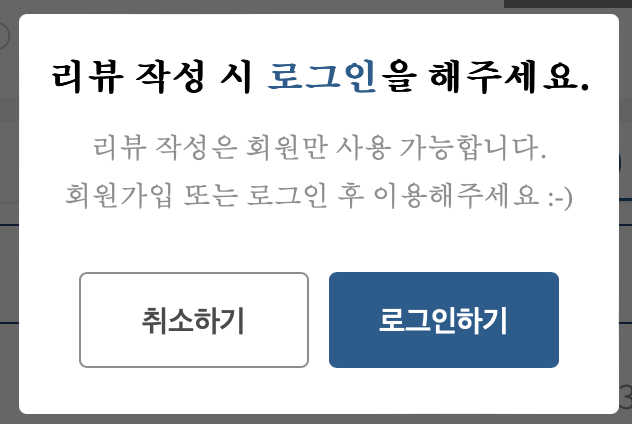
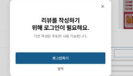
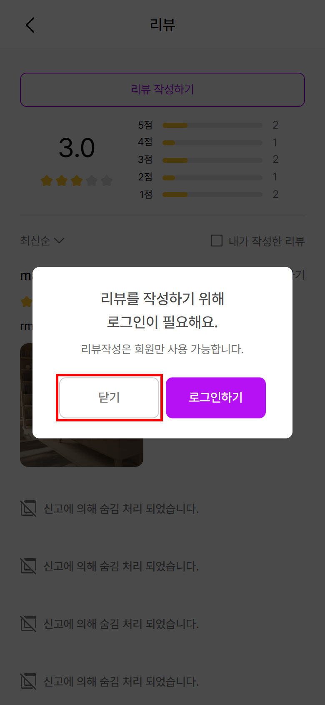

# 3-23 상점상세 리뷰작성 _로그인_취소  (클릭) 

[← 주변상점 목록](README.md)

플랫폼: WEB, ANDROID, IOS  
원문 상태: 완료  
[Notion 기준 명세](https://app.notion.com/p/aa10221954bc83a48c8901b9675a3348)  
원본 ID: `aa10221954bc83a48c8901b9675a3348`

<!-- notion-body:start -->
## 과거 로깅

event\_params.key

- event\_label : shop\_detail\_view\_review\_write\_cancel
- value : \{상점이름\}
- event\_category : click

  



## 새 로깅

- 설명: 로그인하지 않은 상태에서 리뷰 작성을 누르면 뜨는 로그인 안내 팝업에서 취소 버튼을 클릭하는 경우
- screen\_view: <code>shop_detail</code>
- event\_name: <code>DA2</code>
- event\_label: <code>account__shop_detail__login_popup__close__click</code>
- value: \{상점이름\} (예: 복지관 매점)
- event\_category: <code>click</code>

### 참고사진 (비로그인 리뷰 작성 → 취소)

<b>웹</b>

<b>참고사진 · 웹</b>

웹 — 로그인 팝업 취소 클릭 (출처: 기존 캡처)



<b>모바일</b>

<b>참고사진 · 모바일</b>

모바일 — 로그인 팝업 취소 클릭 (출처: stage 실제 캡처, 빨간 네모 = 클릭 위치)


<!-- notion-body:end -->

<details>
<summary>Notion 원문 속성 전체</summary>

```json
{
  "platform": [
    "WEB",
    "ANDROID",
    "IOS"
  ],
  "url": "https://app.notion.com/p/aa10221954bc83a48c8901b9675a3348",
  "상태": "완료",
  "생성일": "2026-11-23T13:38:18.429Z",
  "이벤트 이름": "3-23 상점상세 리뷰작성 \\_로그인\\_취소  (클릭) ",
  "태그": [
    "3. 상점 상세 페이지"
  ]
}
```

</details>
