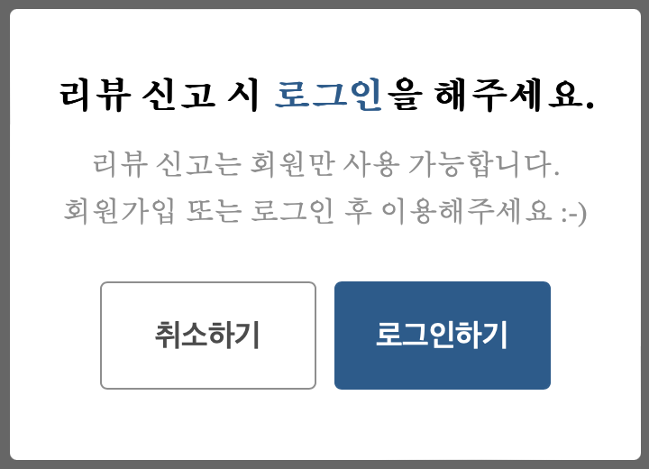
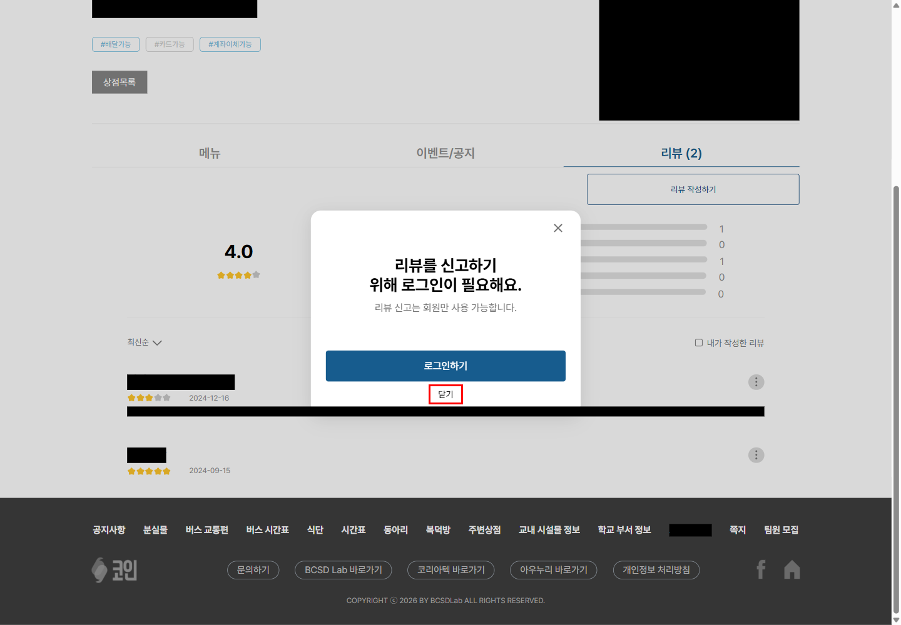
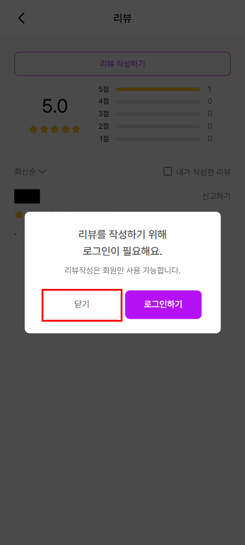

# 3-25 상점상세 리뷰신고 _취소누름 (비로그인)

[← 주변상점 로깅 목록](README.md)

플랫폼: WEB · ANDROID · IOS  
원문 상태: 완료

과거 로깅·새 로깅과 각 참고사진은 원문의 구간별 연결을 유지합니다.

<!-- logging-section:past:start -->
## 과거 로깅

event\_params.key

- event\_label : shop\_detail\_view\_review\_report\_cancel

- value : \{상점이름\} 

- event\_category : click

---

<!-- logging-section:past:end -->

<!-- logging-section:new:start -->
## 새 로깅

- 설명: 로그인하지 않은 상태에서 리뷰 신고를 누르면 뜨는 로그인 안내 팝업에서 취소 버튼을 클릭하는 경우
- screen\_view: <code>shop_detail</code>
- event\_name: <code>DA2</code>
- event\_label: <code>account__shop_detail__login_popup__close__click</code>
- value: \{상점이름\} (예: 복지관 매점)
- event\_category: <code>click</code>

### 참고사진 (비로그인 리뷰 신고 → 취소)

<b>웹</b>

<b>참고사진 · 웹</b>

WEB · [koreatech.in](http://koreatech.in) 운영 사이트 비로그인 리뷰 신고 안내 → 닫기. 실제 신고 안내 문구를 확인했다. 빨간 테두리=닫기. 닉네임·리뷰 본문·연락처가 포함될 수 있는 영역은 검은색 마스킹.

<b>모바일</b>

<b>참고사진 · 모바일</b>

모바일 웹 · 실제 신고하기를 눌러 열린 현행 보라색 로그인 안내의 닫기. 신고 경로에서도 리뷰 작성 문구가 표시됨을 확인했다. 빨간 테두리=닫기. 닉네임 검은색 마스킹.

<!-- logging-section:new:end -->

---

원문 정보

원본 ID: `4a20221954bc832da58181b5fede2885`  
[보존 원문](../../_archive/original/notion/pages/4a20221954bc832da58181b5fede2885.md)

