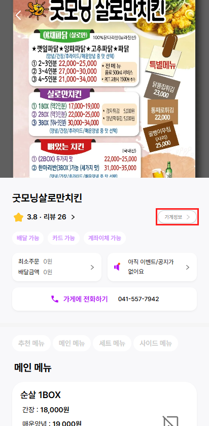

# 3-26 상점상세 가게정보 진입 (클릭)

[← 주변상점 목록](README.md)

플랫폼: IOS, ANDROID  
원문 상태: 로깅 필요  
[Notion 기준 명세](https://app.notion.com/p/f240221954bc8321a89581a00f515059)  
원본 ID: `f240221954bc8321a89581a00f515059`

<!-- notion-body:start -->
## 과거 로깅

- event\_label: <code>shop_detail_view_info</code>
- value: \{상점이름\}
- event\_category: click

## 새 로깅

- 설명: 상점 상세에서 가게정보 더보기 또는 최소주문금액·배달요금 영역을 눌러 가게정보 화면으로 진입할 때 기록한다.
- screen\_view: <code>shop_detail</code>
- event\_name: <code>DA1</code>
- event\_label: <code>shop__shop_detail__shop_info__entry__click</code>
- value: \{상점이름\}
- event\_category: <code>click</code>

### 참고사진

<b>웹</b>

PC 웹: 가게정보를 상세 화면에 바로 표시하며 별도 진입 버튼 없음.

<b>모바일</b>


Stage 모바일 웹 · 가게정보 진입 버튼
<!-- notion-body:end -->

<details>
<summary>Notion 원문 속성 전체</summary>

```json
{
  "platform": [
    "IOS",
    "ANDROID"
  ],
  "url": "https://app.notion.com/p/f240221954bc8321a89581a00f515059",
  "상태": "로깅 필요",
  "생성일": "2026-11-23T13:38:15.809Z",
  "이벤트 이름": "3-26 상점상세 가게정보 진입 (클릭)",
  "태그": [
    "3. 상점 상세 페이지"
  ]
}
```

</details>
