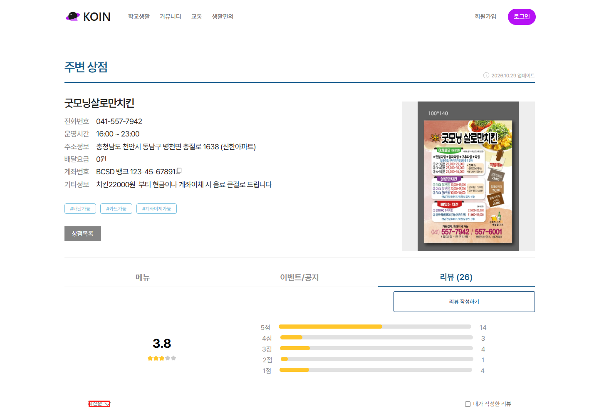
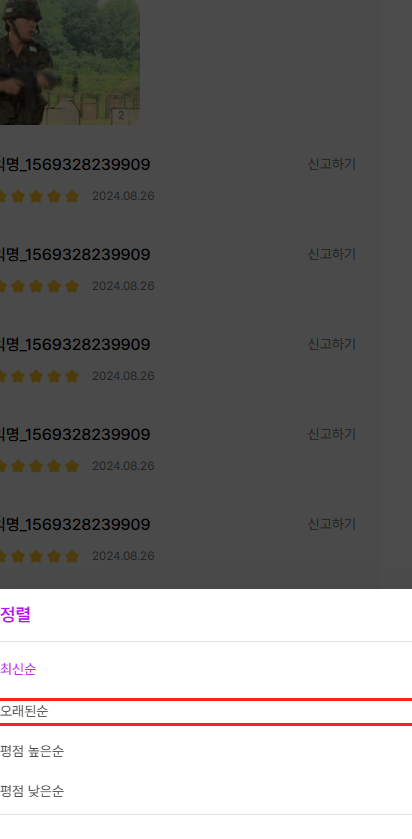

# 3-27 상점상세 리뷰 정렬 (클릭)

[← 주변상점 목록](README.md)

플랫폼: IOS, ANDROID  
원문 상태: 로깅 필요  
[Notion 기준 명세](https://app.notion.com/p/a9a0221954bc8332aaca812a20fdc6b8)  
원본 ID: `a9a0221954bc8332aaca812a20fdc6b8`

<!-- notion-body:start -->
## 과거 로깅

- event\_label: <code>shop_detail_view_review_can</code>
- value: 최신순 / 오래된순 / 별점높은순 / 별점낮은순
- event\_category: click

## 새 로깅

- 설명: 상점 상세 리뷰의 정렬 선택창에서 정렬 기준을 선택했을 때 기록한다. 정렬 선택창을 열기만 한 경우와 상점 목록 정렬은 포함하지 않는다.
- screen\_view: <code>shop_detail</code>
- event\_name: <code>DA1</code>
- event\_label: <code>shop__shop_detail__filter__review_sort__click</code>
- value: \{선택한 리뷰 정렬 기준\} (최신순 / 오래된순 / 별점높은순 / 별점낮은순)
- event\_category: <code>click</code>

### 참고사진

<b>웹</b>


Stage PC 웹 · 정렬 버튼을 연 후 항목을 선택할 때 기록

<b>모바일</b>


Stage 모바일 웹 · 정렬 선택창에서 항목 선택
<!-- notion-body:end -->

<details>
<summary>Notion 원문 속성 전체</summary>

```json
{
  "platform": [
    "IOS",
    "ANDROID"
  ],
  "url": "https://app.notion.com/p/a9a0221954bc8332aaca812a20fdc6b8",
  "상태": "로깅 필요",
  "생성일": "2026-11-23T13:38:19.352Z",
  "이벤트 이름": "3-27 상점상세 리뷰 정렬 (클릭)",
  "태그": [
    "3. 상점 상세 페이지"
  ]
}
```

</details>
