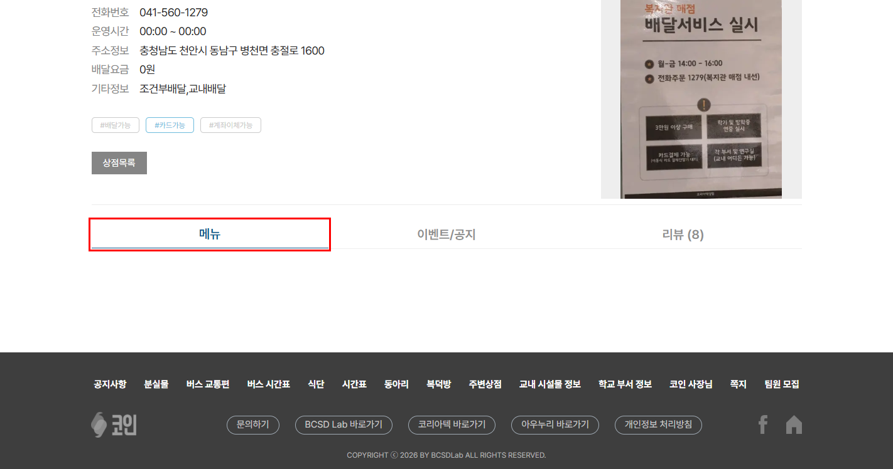
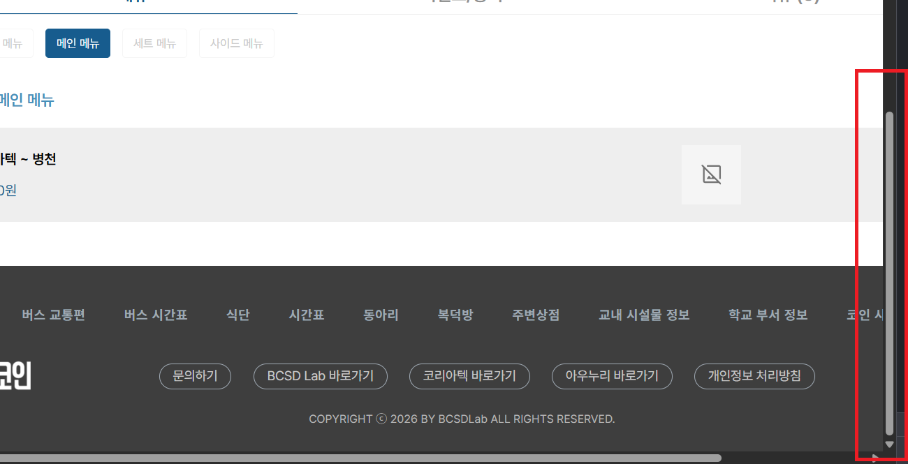
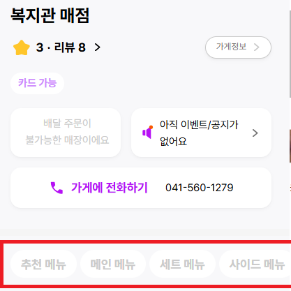
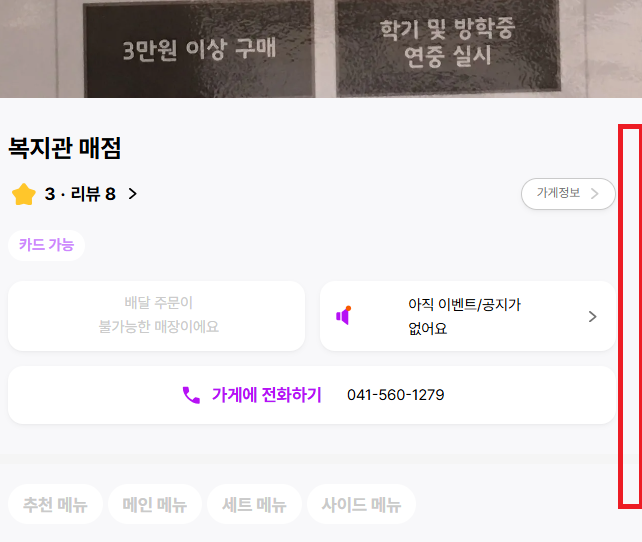

# 3-4, 4.5 상점상세 메뉴 (클릭,스크롤) 

[← 주변상점 목록](README.md)

플랫폼: WEB, ANDROID, IOS  
원문 상태: 완료  
[Notion 기준 명세](https://app.notion.com/p/f410221954bc8337a87c015d4bcdf9de)  
원본 ID: `f410221954bc8337a87c015d4bcdf9de`

<!-- notion-body:start -->
## 과거 로깅

event\_params.key

- event\_label : shop\_detail\_view
- value : \{상점이름\}
- event\_category :

  - scroll
  - click

---

상점 상세에서 아래로 내려가면 찍히는 이벤트 입니다. 

또한 메뉴탭을 누르면 클릭 이벤트를 발생시킵니다. 

---

### 오류사항

---

안드로이드 

- 메뉴를 누르는 이벤트가 있지 않음.

[해결 (1)](https://app.notion.com/p/4bf0221954bc835f97e901a671bd0cf9)

## 새 로깅

① 메뉴 탭 클릭

- 설명: 상점 상세 화면에서 메뉴 탭을 클릭하는 경우
- screen\_view: <code>shop_detail</code>
- event\_name: <code>DA1</code>
- event\_label: <code>shop__shop_detail__shop_menu__entry__click</code>
- value: \{상점이름\} (예: 복지관 매점)
- event\_category: <code>click</code>

② 메뉴 스크롤

- 설명: 상점 상세 화면에서 메뉴 목록을 아래로 스크롤하는 경우
- screen\_view: <code>shop_detail</code>
- event\_name: <code>DA1</code>
- event\_label: <code>shop__shop_detail__shop_menu__scroll</code>
- value: \{상점이름\} (예: 복지관 매점)
- event\_category: <code>scroll</code>

### 참고사진 (상점 상세 메뉴)

<b>웹</b>

<b>참고사진 · 웹</b>

웹 — ① 메뉴 탭 클릭 (출처: stage 실제 캡처, 빨간 네모 = 클릭 위치)



웹 — ② 메뉴 스크롤 (출처: 기존 캡처)



<b>모바일</b>

<b>참고사진 · 모바일</b>

모바일 — ① 메뉴 탭 클릭 (출처: 기존 캡처)



모바일 — ② 메뉴 스크롤 (출처: 기존 캡처)


<!-- notion-body:end -->

<details>
<summary>Notion 원문 속성 전체</summary>

```json
{
  "platform": [
    "WEB",
    "ANDROID",
    "IOS"
  ],
  "url": "https://app.notion.com/p/f410221954bc8337a87c015d4bcdf9de",
  "상태": "완료",
  "생성일": "2026-11-23T13:38:16.356Z",
  "이벤트 이름": "3-4, 4.5 상점상세 메뉴 (클릭,스크롤) ",
  "태그": [
    "3. 상점 상세 페이지"
  ]
}
```

</details>
