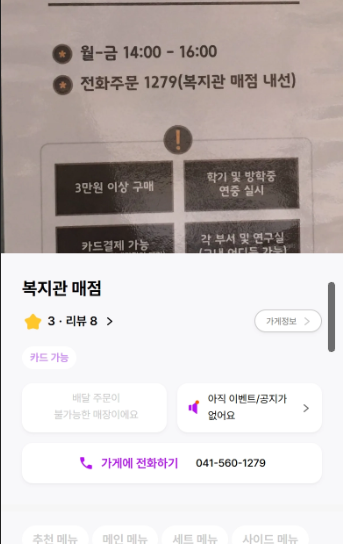

# 3-5-3 상점상세 뒤로 가기 (Swipe)

[← 주변상점 로깅 목록](README.md)

플랫폼: WEB · ANDROID · IOS  
원문 상태: 완료

과거 로깅·새 로깅과 각 참고사진은 원문의 구간별 연결을 유지합니다.

<!-- logging-section:past:start -->
## 과거 로깅

event\_params.key

- event\_label : shop\_detail\_view\_back

- value : \{상점이름\} 

- event\_category : 

- swipe

- current\_page : \{돌아간 카테고리\}
- duration\_time : 상점 상세보기에서 카테고리로 돌아간 시간.

---

카테고리 의미 

- 뒤로가기 버튼을 눌러 상점 카테고리 페이지로 돌아가는 것.

시간 관련 주의 사항: 

<ol>

- 상점 상세보기 페이지에서 어떠한 행위를 해도 상관이 없음.  즉 상점 상세보기를 들어온 시간부터 상점 상세보기를 떠난 시간까지 측정 

</ol>

---

### 오류사항

햄버거로 나가는걸 측정하지 못하고 있음. 

웹: 

상점 목록으로 나가면 swipe 이벤트가 찍히고 있음. 

안드: 

swipe → click 

---

[해결 (4)](../../_archive/original/notion/pages/8630221954bc8394bd4081da0470d546.md)

<!-- logging-section:past:end -->

<!-- logging-section:new:start -->
## 새 로깅

- 설명: 상점 상세 화면에서 나가는 경우
- screen\_view: <code>shop_detail</code>
- event\_name: <code>DA1</code>
- event\_label: <code>shop__shop_detail__navigation__back__swipe</code>
- value: 스와이프
- event\_category: <code>swipe</code>

### 참고사진 (상점 상세 뒤로가기)

웹 - 없음

#### 모바일

모바일 — 뒤로가기 클릭 (출처: stage 실제 캡처, 빨간 네모 = 클릭 위치)

<!-- logging-section:new:end -->

---

원문 정보

원본 ID: `2250221954bc83f79b9b01b326d94320`  
[보존 원문](../../_archive/original/notion/pages/2250221954bc83f79b9b01b326d94320.md)

