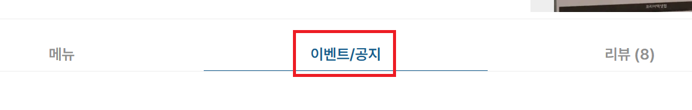
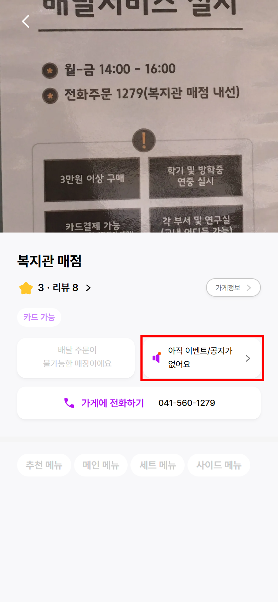

# 3-8 상점상세 이벤트 (클릭)

[← 주변상점 로깅 목록](README.md)

플랫폼: WEB · ANDROID · IOS  
원문 상태: 완료

과거 로깅·새 로깅과 각 참고사진은 원문의 구간별 연결을 유지합니다.

<!-- logging-section:past:start -->
## 과거 로깅

event\_params.key

- event\_label : shop\_detail\_view\_event

- value : \{상점이름\} 

- event\_category : click

<!-- logging-section:past:end -->

<!-- logging-section:new:start -->
## 새 로깅

- 설명: 상점 상세 화면에서 가게의 이벤트(진행 중인 혜택·이벤트 영역)를 클릭하는 경우
- screen\_view: <code>shop_detail</code>
- event\_name: <code>DA1</code>
- event\_label: <code>shop__shop_detail__shop_event__entry__click</code>
- value: \{상점이름\} (예: 복지관 매점)
- event\_category: <code>click</code>

### 참고사진 (상점 상세 이벤트 클릭)

<b>웹</b>

<b>참고사진 · 웹</b>

웹 — 이벤트 영역 클릭 (출처: 기존 캡처)

<b>모바일</b>

<b>참고사진 · 모바일</b>

모바일 — 이벤트 영역 클릭 (출처: stage 실제 캡처, 빨간 네모 = 클릭 위치)

<!-- logging-section:new:end -->

---

원문 정보

원본 ID: `a9b0221954bc825aafbb01805be5fbbe`  
[보존 원문](../../_archive/original/notion/pages/a9b0221954bc825aafbb01805be5fbbe.md)

