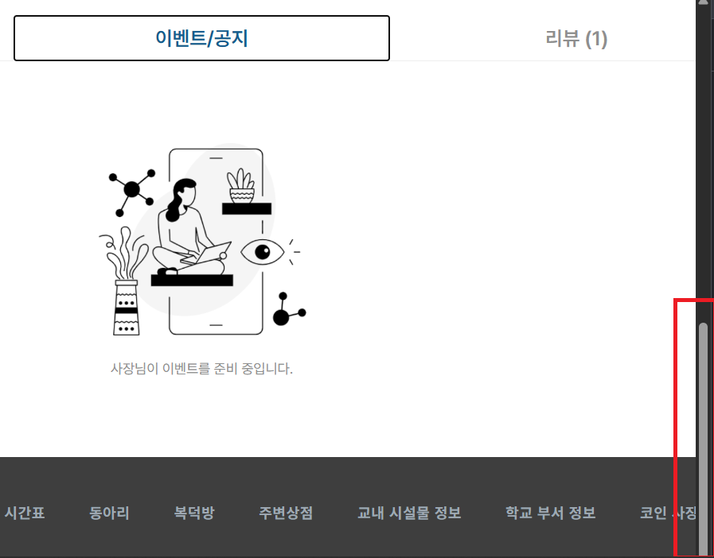

# 3-9 상점상세 이벤트 (스크롤) 

[← 주변상점 목록](README.md)

플랫폼: WEB, ANDROID, IOS  
원문 상태: 완료  
[Notion 기준 명세](https://app.notion.com/p/bfe0221954bc830aaeb381a247f8733b)  
원본 ID: `bfe0221954bc830aaeb381a247f8733b`

<!-- notion-body:start -->
## 과거 로깅

event\_params.key

- event\_label : shop\_detail\_view\_event
- value : \{상점이름\}
- event\_category : scroll

### 오류사항

안드 

- 스크롤 안되는 이슈

## 새 로깅

- 설명: 상점 상세 화면에서 가게의 이벤트(진행 중인 혜택·이벤트 영역)를 스크롤하는 경우
- screen\_view: <code>shop_detail</code>
- event\_name: <code>DA1</code>
- event\_label: <code>shop__shop_detail__shop_event__scroll</code>
- value: \{상점이름\} (예: 복지관 매점)
- event\_category: <code>scroll</code>

### 참고사진 (상점 상세 이벤트 스크롤)

<b>웹</b>

<b>참고사진 · 웹</b>



<b>모바일</b>

<b>참고사진 · 모바일</b>


모바일 웹 · 운영 왕십리야식의 보라색 리디자인 이벤트/공지 목록. 빨간 테두리=실제 이벤트 카드 목록. 현재 1개 카드이며 실제 스크롤 발생·SDK 전송 검증과 구분한다.

구버전 모바일 사진을 제거하고 현행 보라색 모바일 웹 사진으로 보완했다.
<!-- notion-body:end -->

<details>
<summary>Notion 원문 속성 전체</summary>

```json
{
  "platform": [
    "WEB",
    "ANDROID",
    "IOS"
  ],
  "url": "https://app.notion.com/p/bfe0221954bc830aaeb381a247f8733b",
  "상태": "완료",
  "생성일": "2026-11-23T13:38:16.918Z",
  "이벤트 이름": "3-9 상점상세 이벤트 (스크롤) ",
  "태그": [
    "3. 상점 상세 페이지"
  ]
}
```

</details>
