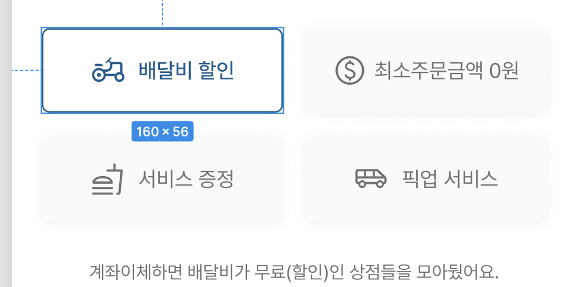
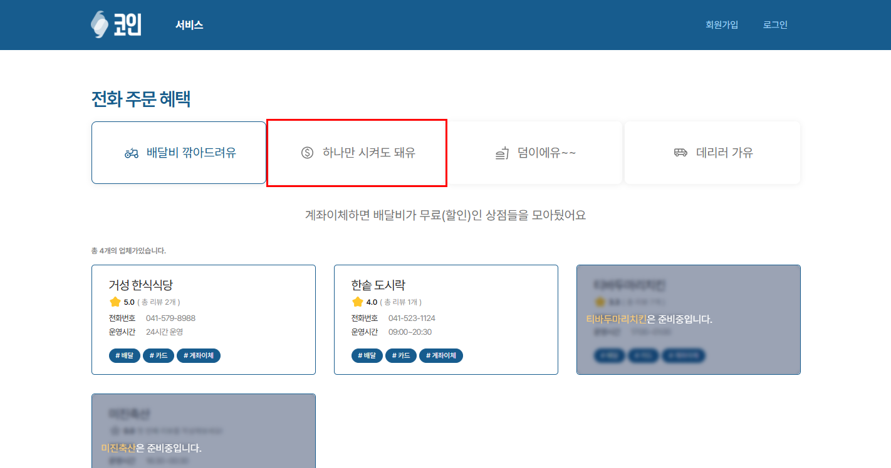

# 4-2 전화 주문 혜택 페이지 버튼 → 버튼

[← 주변상점 로깅 목록](README.md)

플랫폼: WEB · ANDROID · IOS  
원문 상태: 완료

과거 로깅·새 로깅과 각 참고사진은 원문의 구간별 연결을 유지합니다.

<!-- logging-section:past:start -->
## 과거 로깅

event\_params.key

- event\_label : benefit\_shop\_categories

- value : \{버튼\}   //  (배달비, 최소주문금액, 서비스, 픽업) 

- event\_category : click  

- previous\_page : \{이전카테고리\}

- current\_page : \{현재 카테고리\}

- duration\_time : 이전 카테고리에서 현 카테고리로 이동하는 시간 

<!-- logging-section:past:end -->

<!-- logging-section:new:start -->
## 새 로깅

- 설명: 전화 주문 혜택 화면에서 혜택 카테고리 버튼(배달비, 최소주문금액, 서비스, 픽업)을 클릭하는 경우
- screen\_view: <code>shop_benefit</code>
- event\_name: <code>DA1</code>
- event\_label: <code>shop__shop_benefit__filter__category__click</code>
- value: \{사용자가 클릭한 혜택 카테고리\} (예: 배달비)
- event\_category: <code>click</code>

### 참고사진 (혜택 카테고리 버튼)

<b>웹</b>

<b>참고사진 · 웹</b>

웹 — 혜택 카테고리 버튼 클릭 (출처: stage 실제 캡처, 빨간 네모 = 클릭 위치)

<b>모바일</b>

<b>참고사진 · 모바일</b>

파란색 구버전 모바일 사진 제거 (2026-10-30). 보라색 모바일 버전 확인 후 보완.

<!-- logging-section:new:end -->

---

원문 정보

원본 ID: `00c0221954bc82ca877e8135cfa16d9d`  
[보존 원문](../../_archive/original/notion/pages/00c0221954bc82ca877e8135cfa16d9d.md)

