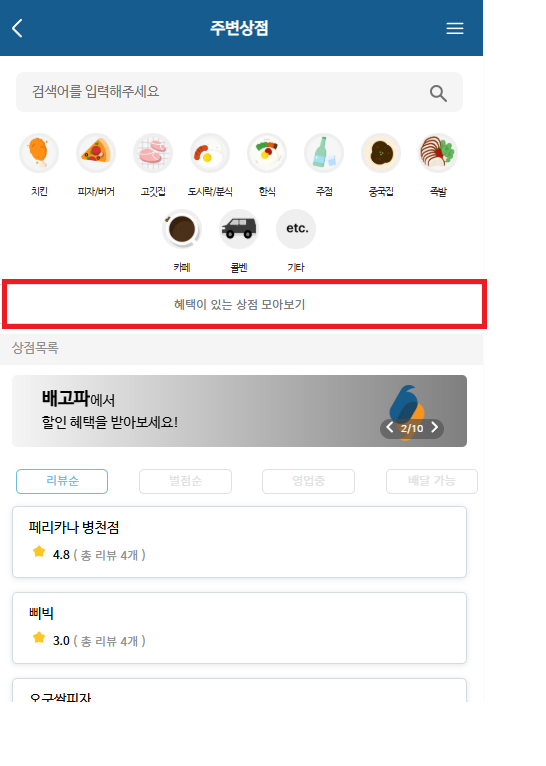
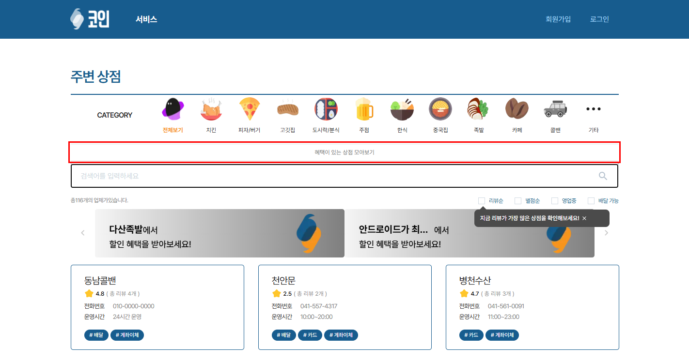

# 4-3 카테고리에서 혜택페이지(클릭)

[← 주변상점 로깅 목록](README.md)

플랫폼: WEB · ANDROID · IOS  
원문 상태: 완료

과거 로깅·새 로깅과 각 참고사진은 원문의 구간별 연결을 유지합니다.

<!-- logging-section:past:start -->
## 과거 로깅

event\_params.key

- event\_label : shop\_categories\_benefit

- value : 혜택이 있는 상점 모아보기

- event\_category : click  

- previous\_page : \{이전카테고리\}

- current\_page : benefit

- duration\_time : 이전 카테고리에서 현 카테고리로 이동하는 시간 

<!-- logging-section:past:end -->

<!-- logging-section:new:start -->
## 새 로깅

- 설명: 상점 목록 화면에서 "혜택이 있는 상점 모아보기"를 클릭해 전화 주문 혜택 화면으로 이동하는 경우
- screen\_view: <code>shop_list</code>
- event\_name: <code>DA1</code>
- event\_label: <code>shop__shop_list__shop_benefit__entry__click</code>
- value: 혜택이 있는 상점 모아보기
- event\_category: <code>click</code>

### 참고사진 (혜택 상점 모아보기)

#### 웹

웹 — 혜택이 있는 상점 모아보기 클릭 (출처: stage 실제 캡처, 빨간 네모 = 클릭 위치)

파란색 구버전 모바일 사진 제거 (2026-10-30).

<!-- logging-section:new:end -->

---

원문 정보

원본 ID: `8880221954bc8336a6e58126f53b3ce6`  
[보존 원문](../../_archive/original/notion/pages/8880221954bc8336a6e58126f53b3ce6.md)

