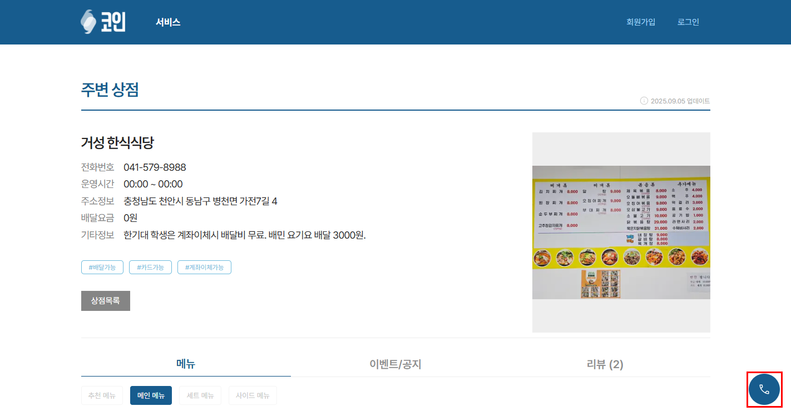

# 4-5 전화 주문 혜택 상점상세 전화 (클릭)

[← 주변상점 로깅 목록](README.md)

플랫폼: WEB · ANDROID · IOS  
원문 상태: 완료

과거 로깅·새 로깅과 각 참고사진은 원문의 구간별 연결을 유지합니다.

<!-- logging-section:past:start -->
## 과거 로깅

event\_params.key

- event\_label : benefit\_shop\_call

- value : \{상점이름\} 

- event\_category : click

- duration\_time : 상점 상세페이지로 들어와서 전화를 하기까지 걸린시간. 

<!-- logging-section:past:end -->

<!-- logging-section:new:start -->
## 새 로깅

- 설명: 전화 주문 혜택 화면을 거쳐 들어간 상점 상세 화면에서 전화 버튼을 클릭하는 경우
- screen\_view: <code>shop_detail</code>
- event\_name: <code>DA1</code>
- event\_label: <code>shop__shop_detail__contact__phone__click</code>
- value: \{상점이름\} (예: 복지관 매점)
- event\_category: <code>click</code>

### 참고사진 (혜택 경유 상점 상세 전화)

#### 웹

웹 — 오른쪽 아래 전화 버튼 클릭 (출처: stage 실제 캡처, 빨간 네모 = 클릭 위치)

파란색 구버전 모바일 사진 제거 (2026-10-30).

<!-- logging-section:new:end -->

---

원문 정보

원본 ID: `98a0221954bc836e8fcf01f13cefc418`  
[보존 원문](../../_archive/original/notion/pages/98a0221954bc836e8fcf01f13cefc418.md)

