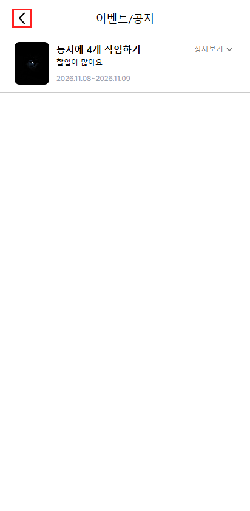

# 4-6 상점 혜택 화면 뒤로가기 (Click · Swipe)

[← 주변상점 목록](README.md)

플랫폼: IOS, ANDROID  
원문 상태: 로깅 필요  
[Notion 기준 명세](https://app.notion.com/p/6010221954bc83ecaa0d01f8bb852fea)  
원본 ID: `6010221954bc83ecaa0d01f8bb852fea`

<!-- notion-body:start -->
## 과거 로깅

- event\_label: <code>shop_benefit_back</code>
- value: \{상점이름\}
- event\_category: click

## 새 로깅

### 뒤로가기 버튼

- 설명: 특정 상점의 혜택 화면에서 뒤로가기 버튼 또는 뒤로가기 스와이프로 이전 화면으로 돌아가는 전환이 완료되었을 때 기록한다. 취소된 스와이프는 포함하지 않는다.
- screen\_view: <code>shop_benefit</code>
- event\_name: <code>DA1</code>
- event\_label: <code>shop__shop_benefit__navigation__back__click</code>
- value: \{상점이름\}
- event\_category: <code>click</code>

### 뒤로가기 스와이프

- 설명: 특정 상점의 혜택 화면에서 뒤로가기 버튼 또는 뒤로가기 스와이프로 이전 화면으로 돌아가는 전환이 완료되었을 때 기록한다. 취소된 스와이프는 포함하지 않는다.
- screen\_view: <code>shop_benefit</code>
- event\_name: <code>DA1</code>
- event\_label: <code>shop__shop_benefit__navigation__back__swipe</code>
- value: \{상점이름\}
- event\_category: <code>swipe</code>

### 참고사진

<b>웹</b>

PC 웹: 이벤트/공지 탭 방식이며 별도 혜택 화면의 뒤로가기 버튼 없음.

<b>모바일</b>


Stage 모바일 웹 · 해당 상점의 이벤트/공지 화면 뒤로가기
<!-- notion-body:end -->

<details>
<summary>Notion 원문 속성 전체</summary>

```json
{
  "platform": [
    "IOS",
    "ANDROID"
  ],
  "url": "https://app.notion.com/p/6010221954bc83ecaa0d01f8bb852fea",
  "상태": "로깅 필요",
  "생성일": "2026-11-23T13:38:19.197Z",
  "이벤트 이름": "4-6 상점 혜택 화면 뒤로가기 (Click · Swipe)",
  "태그": [
    "4. 혜택 페이지"
  ]
}
```

</details>
