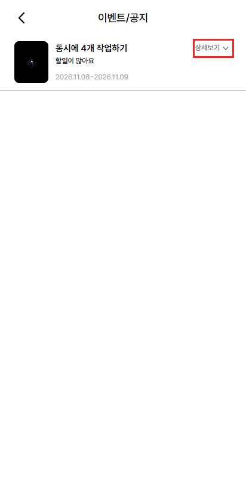

# 4-7 상점 혜택 문구 펼치기 (클릭)

[← 주변상점 목록](README.md)

플랫폼: IOS, ANDROID  
원문 상태: 로깅 필요  
[Notion 기준 명세](https://app.notion.com/p/ee70221954bc82c69fdc01063313bb55)  
원본 ID: `ee70221954bc82c69fdc01063313bb55`

<!-- notion-body:start -->
## 과거 로깅

- event\_label: <code>shop_benefit_detail</code>
- value: \{상점이름\}
- event\_category: click

## 새 로깅

- 설명: 특정 상점의 혜택 화면에서 접힌 이벤트·혜택 문구를 펼쳤을 때 기록한다. 이미 펼친 문구를 접는 경우와 상점 상세의 이벤트 탭 진입은 포함하지 않는다.
- screen\_view: <code>shop_benefit</code>
- event\_name: <code>DA1</code>
- event\_label: <code>shop__shop_benefit__shop_event__expand__click</code>
- value: \{상점이름\}
- event\_category: <code>click</code>

### 참고사진

<b>웹</b>

PC 웹: 이벤트 내용을 바로 표시하며 같은 문구 펼치기 버튼 없음.

<b>모바일</b>


Stage 모바일 웹 · 접힌 혜택 문구의 상세보기 버튼
<!-- notion-body:end -->

<details>
<summary>Notion 원문 속성 전체</summary>

```json
{
  "platform": [
    "IOS",
    "ANDROID"
  ],
  "url": "https://app.notion.com/p/ee70221954bc82c69fdc01063313bb55",
  "상태": "로깅 필요",
  "생성일": "2026-11-23T13:38:18.985Z",
  "이벤트 이름": "4-7 상점 혜택 문구 펼치기 (클릭)",
  "태그": [
    "4. 혜택 페이지"
  ]
}
```

</details>
