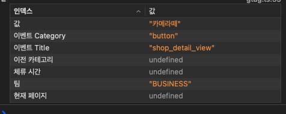

# 해결 (1)

[← 주변상점 로깅 목록](README.md)

원문에 과거·새 로깅 구분이 없어 아래 정의와 참고사진을 원문 순서로 표시합니다.

원문 미기재 항목: `event_name`, `screen_view`. 값을 추정하지 않았습니다.

웹: 

<ol>

- 현재 이벤트가 찍혀 있지 않음. ? 

</ol>

→ 혹은 이벤트 카테고리를 button에서 scroll로 바꾸시는걸 깜빡하신게 아닐까… 

<ol start="2">

- 추가로 스크롤 이벤트 말고 click 이벤트도 추가해주실수 있나요?  ex) 리뷰 탭에서 메뉴 탭으로 이동하면 

</ol>

예시

- event\_label : shop\_detail\_view

- value : \{상점이름\} 

- event\_category : click

---

원문 정보

원본 ID: `4800221954bc83e7920481d814584d1e`  
[보존 원문](../../_archive/original/notion/pages/4800221954bc83e7920481d814584d1e.md)

