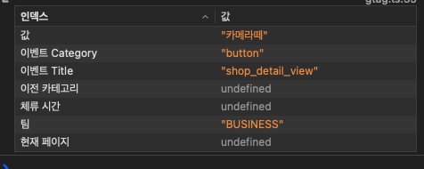

# 해결 (1)

[← 주변상점 목록](README.md)

플랫폼:   
원문 상태:   
[Notion 기준 명세](https://app.notion.com/p/4bf0221954bc835f97e901a671bd0cf9)  
원본 ID: `4bf0221954bc835f97e901a671bd0cf9`

<!-- notion-body:start -->
웹: 

- 현재 이벤트가 찍혀 있지 않음. ?



→ 혹은 이벤트 카테고리를 button에서 scroll로 바꾸시는걸 깜빡하신게 아닐까… 

- 추가로 스크롤 이벤트 말고 click 이벤트도 추가해주실수 있나요? <br />ex) 리뷰 탭에서 메뉴 탭으로 이동하면

## 예시

- event\_label : shop\_detail\_view
- value : \{상점이름\}
- event\_category : click
<!-- notion-body:end -->

<details>
<summary>Notion 원문 속성 전체</summary>

```json
{
  "title": "해결 (1)"
}
```

</details>
