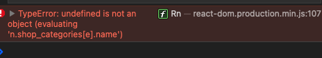

# 해결 (1)

[← 주변상점 로깅 목록](README.md)

원문에 과거·새 로깅 구분이 없어 아래 정의와 참고사진을 원문 순서로 표시합니다.

원문 미기재 항목: `event_name`, `event_label`, `screen_view`, `value`, `event_category`. 값을 추정하지 않았습니다.

웹: 

<ol>

- 헤더나 푸터를 이용하여 주변상점을 들어온뒤 검색 버튼을 누르면 에러가 남. 

</ol>

→ 전체 보기값 을  넣어서 처리해주시면 될 거 같습니다. 

---

원문 정보

원본 ID: `5c50221954bc82f797d081266d484004`  
[보존 원문](../../_archive/original/notion/pages/5c50221954bc82f797d081266d484004.md)

