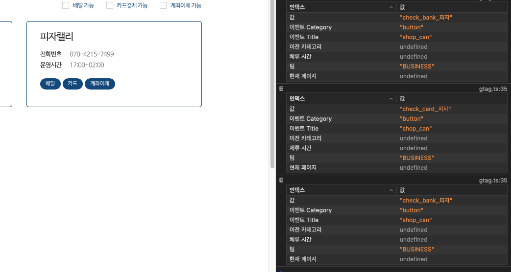
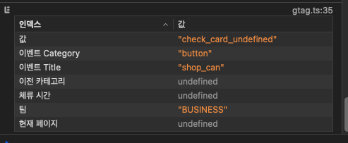

# 해결 (1)

[← 주변상점 목록](README.md)

플랫폼:   
원문 상태:   
[Notion 기준 명세](https://app.notion.com/p/9620221954bc821d96770147757a0471)  
원본 ID: `9620221954bc821d96770147757a0471`

<!-- notion-body:start -->
웹 

- 체크 표시를 풀때 이벤트가 발생



→ 토글을 누를때 바로 이벤트가 생성되게 해주시면 되겠습니다. 

추가로 토글을 해제할때는 이벤트가 생성 되지 않아도 됩니다. 

- 헤더나 푸터를 통해 들어올때 이슈 발생



→ 전체보기 값으로 들어오면 될거 같습니다! 

- 반응형 웹 이슈

반응형 웹에서는 토글 자체를 이벤트를 측정하지 못하고 있습니다. 

추가해주시면 감사하겠습니다! → 신규 이벤트로 넣어주시면 되겠습니다!
<!-- notion-body:end -->

<details>
<summary>Notion 원문 속성 전체</summary>

```json
{
  "title": "해결 (1)"
}
```

</details>
