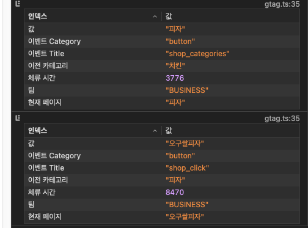

# 해결 (1)

[← 주변상점 목록](README.md)

플랫폼:   
원문 상태:   
[Notion 기준 명세](https://app.notion.com/p/d520221954bc831e95ec818df511e605)  
원본 ID: `d520221954bc831e95ec818df511e605`

<!-- notion-body:start -->
웹: 

- 카테고리 이동 후 상점을 클릭하면 체류 시간이 중첩되어 적힙니다.



→ 카테고리 이동을 하면 타이머를 리셋하고 상점으로 들어가는 시간을 체크 해주시면 되겠습니다. 

---

안드로이드 

상점에서 나갔다가 다시 들어와도 시간이 중복되는 이슈
<!-- notion-body:end -->

<details>
<summary>Notion 원문 속성 전체</summary>

```json
{
  "title": "해결 (1)"
}
```

</details>
