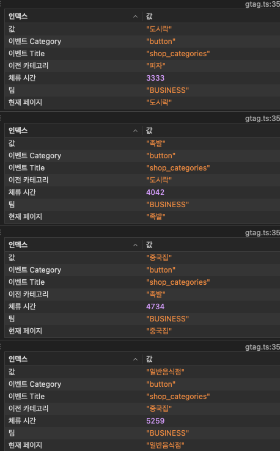
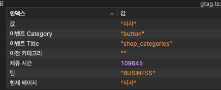

# 해결 (1)

[← 주변상점 로깅 목록](README.md)

원문에 과거·새 로깅 구분이 없어 아래 정의와 참고사진을 원문 순서로 표시합니다.

원문 미기재 항목: `event_name`, `event_label`, `screen_view`, `value`, `event_category`. 값을 추정하지 않았습니다.

---

IOS 

1. 이전 카테고리가 나오지 않는 이슈  

→ 전 카테고리가 나오도록 찍히게 해주세요.

And

<ol>

- 이전 페이지가 겹치는 이슈 발생. 

</ol>

웹 : 

<ol>

- 시간이 중복으로 쌓이는 오류 

</ol>

→ 도시락에서 족발로 이동하면 

도시락에서 쌓여있던 시간은 리셋하고 족발에서 다시 카운트 해주시면 감사하겠습니다. 

<ol start="2">

- 헤더나 푸터를 통해 들어왔을때 이전 카테고리에 공백이 들어오게 됨. 

</ol>

→ 전체보기로 설정해주시면 감사하겠습니다! 

상점카테고리에서 상점 카테고리로의 시간을 파악하고자 합니다. 

주의사항 : 

<ol>

- scroll 이벤트에는  아래 3개의 키값은 안보내야함. 

- 웹에서 배달가능, 카드 가능을 누르게 될경우 페이지가 다르게 잡히는데 이 경우 이벤트가 보내져서는 안됨.  

</ol>

---

안드 

3개 파라미터 추가 안됨. 

---

원문 정보

원본 ID: `1060221954bc8278b7ca81824968cf3c`  
[보존 원문](../../_archive/original/notion/pages/1060221954bc8278b7ca81824968cf3c.md)

