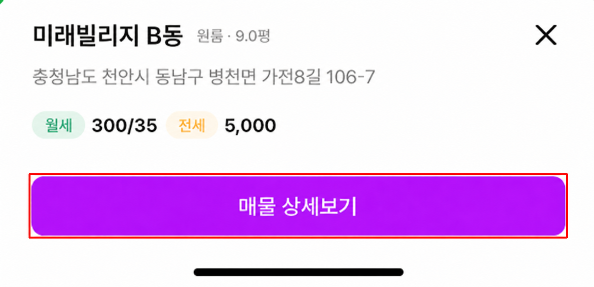

# 2-1-1 복덕방 미리보기_매물 상세보기 버튼 클릭

[← 로깅 목록](README.md)

생성일: 2026년 11월 19일 오후 2:33
platform: ANDROID, IOS
상태: 로깅 필요

## 새 로깅

- 설명: 앱 복덕방 지도·목록에서 선택한 매물의 미리보기 패널에 있는 보라색 ‘매물 상세보기’ 버튼을 누를 때 클릭 1회당 기록한다. 클릭 시 선택한 매물의 상세 화면 진입을 요청한다.
- screen_view: `room_list`
- event_name: `DA1`
- event_label: `real_estate__room_list__room_detail__button_entry__click`
- value: {방 이름} (예: 미래빌리지 B동)
- event_category: `click`

### 사진 (매물 상세보기 버튼)

**모바일**

**참고사진 · 모바일**

모바일 — 빨간 네모 = 미리보기 패널의 ‘매물 상세보기’ 버튼. 사용자 제공 디자인을 편집한 참고사진이며 실기기·SDK 검증 사진은 아니다.