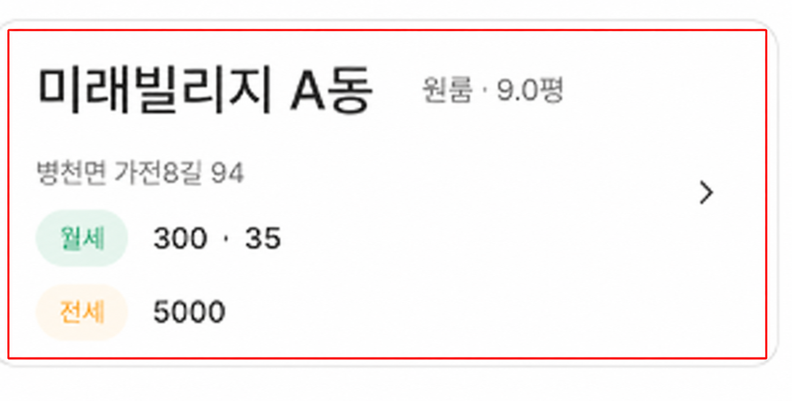
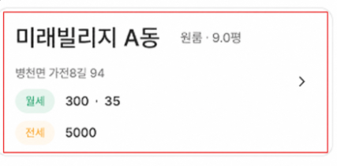

# 2-1 복덕방 목록_방 카드 클릭 

[← 복덕방 목록](README.md)

플랫폼: ANDROID, IOS, WEB  
원문 상태: 로깅 필요  
[Notion 기준 명세](https://app.notion.com/p/d280221954bc83cbabea01eec44b37a4)  
원본 ID: `d280221954bc83cbabea01eec44b37a4`

<!-- notion-body:start -->
## 새 로깅

- 설명: 복덕방 목록에서 직접 상세로 이동하는 방 카드
- screen\_view: <code>room_list</code>
- event\_name: <code>DA1</code>
- event\_label: <code>real_estate__room_list__room_detail__entry__click</code>
- value: \{방 이름\} (예: 금실타운)
- event\_category: <code>click</code>

### 참고사진 (방 카드)

<b>웹</b>

<b>참고사진 · 웹</b>


웹 — 빨간 네모가 이 명세의 클릭 대상이다. 같은 화면의 다른 동작은 표시하지 않았다. 사용자 제공 WEB 디자인을 편집한 참고사진이며 실기기·SDK 검증 사진은 아니다.

<b>모바일</b>

<b>참고사진 · 모바일</b>


<!-- notion-body:end -->

<details>
<summary>Notion 원문 속성 전체</summary>

```json
{
  "platform": [
    "ANDROID",
    "IOS",
    "WEB"
  ],
  "url": "https://app.notion.com/p/d280221954bc83cbabea01eec44b37a4",
  "상태": "로깅 필요",
  "생성일": "2026-11-23T13:39:04.981Z",
  "이벤트 이름": "2-1 복덕방 목록\\_방 카드 클릭 "
}
```

</details>
