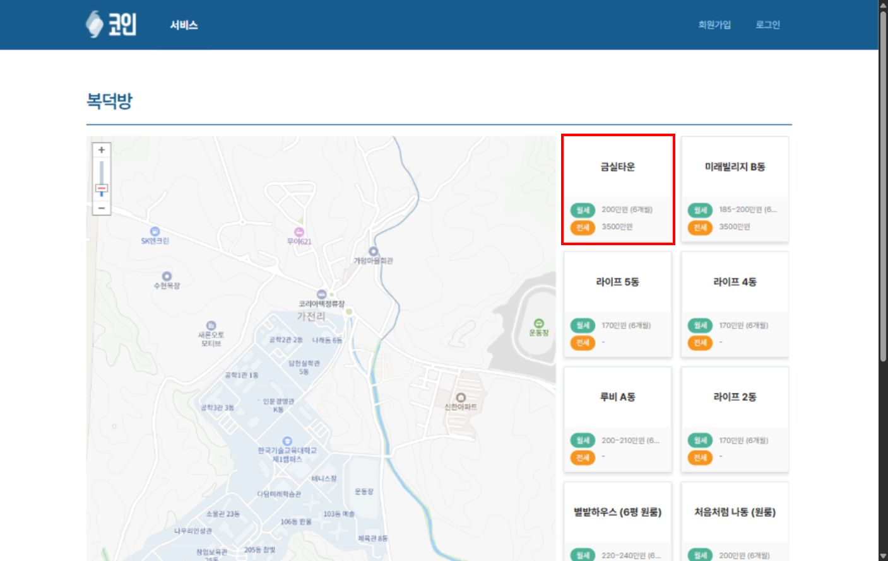

# 2-1 복덕방 목록_방 카드 (클릭) - 추가된 로깅

[← 복덕방 로깅 목록](README.md)

플랫폼: ANDROID · IOS · WEB  
원문 상태: 로깅 필요

과거 로깅·새 로깅과 각 참고사진은 원문의 구간별 연결을 유지합니다.

<!-- logging-section:past:start -->
## 과거 로깅

- 없음 (새로 추가한 로깅)

<!-- logging-section:past:end -->

<!-- logging-section:new:start -->
## 새 로깅

- 설명: 복덕방 목록 화면에서 방 카드를 클릭해 복덕방 상세 화면으로 들어가는 경우
- screen\_view: <code>room_list</code>
- event\_name: <code>DA1</code>
- event\_label: <code>real_estate__room_list__room_detail__entry__click</code>
- value: \{방 이름\} (예: 금실타운)
- event\_category: <code>click</code>

### 참고사진 (방 카드)

<b>웹</b>

<b>참고사진 · 웹</b>

WEB · 빨간 네모: 방 카드 클릭. stage 실제 화면 캡처에 위치 표시.

<b>모바일</b>

<b>참고사진 · 모바일</b>

모바일 웹 · 운영 [https://koreatech.in/room](https://koreatech.in/room) 실제 파란색 화면을 2026-10-30에 캡처. 빨간 테두리: 라이프 5동 방 카드. Android/iOS 네이티브 앱 캡처가 아니며 SDK 발화·한 번 전송은 미확인.

<!-- logging-section:new:end -->

---

원문 정보

원본 ID: `c1c0221954bc8353915281b8ddcf70e4`  
[보존 원문](../../_archive/original/notion/pages/c1c0221954bc8353915281b8ddcf70e4.md)

