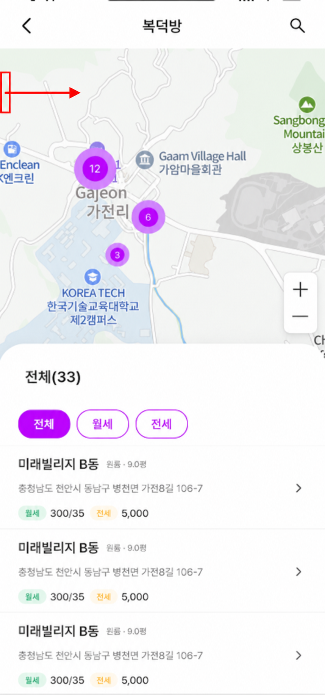

# 2-10-1 뒤로가기 swipe (모바일) - 아이폰만

[← 복덕방 목록](README.md)

플랫폼: IOS  
원문 상태: 로깅 필요  
[Notion 기준 명세](https://app.notion.com/p/9eb0221954bc8275b1ee81e95eee4c33)  
원본 ID: `9eb0221954bc8275b1ee81e95eee4c33`

<!-- notion-body:start -->
## 새 로깅 (26.11.17)

- 설명: iOS 복덕방 목록·검색·매물 상세 화면에서 왼쪽 화면 가장자리부터 오른쪽으로 스와이프하여 이전 화면으로 돌아가는 전환이 완료될 때 1회 기록한다. 화면에 관계없이 동일한 event\_label을 사용하고, 제스처가 발생한 출발 화면은 source\_screen으로 구분한다.
- screen\_view: <code>room_common</code>
- event\_name: <code>DA1</code>
- event\_label: <code>real_estate__room_common__navigation__back__swipe</code>
- value: 뒤로가기
- event\_category: <code>swipe</code>

### 전송 기준

- 적용 플랫폼: IOS. 실제 SDK 구현·배포·수집 여부는 미확인이다.
- 취소되거나 원래 화면으로 복귀한 제스처는 전송하지 않는다.
- 상단 뒤로가기 버튼 클릭은 2-11의 click 계약으로 기록하며 이 swipe 계약을 함께 보내지 않는다.
- 지도 이동, 목록 스크롤, 사진 넘기기 제스처는 포함하지 않는다. 검색 상태와 지도·목록 상태에서도 같은 계약을 사용한다.
- 목록·검색·매물 상세에서 같은 swipe 라벨을 사용하며 screen\_view는 room\_common으로 고정하고 실제 출발 화면을 source\_screen으로 구분한다. 동일 제스처에 화면별 별도 뒤로가기 라벨을 병행 전송하지 않는다.

### 추가 파라미터

- source\_screen: 필수 string. 뒤로가기가 발생한 출발 화면을 기록한다. 목록·검색은 <code>room_list</code>, 매물 상세는 <code>room_detail</code>을 사용한다. 클릭과 스와이프에 동일한 기준을 적용한다.

### 참고사진 (목록·검색 뒤로가기 스와이프)

<b>모바일</b>

<b>참고사진 · 모바일</b>


모바일 — 빨간 네모 = 왼쪽 화면 가장자리의 제스처 시작 영역, 빨간 화살표 = 오른쪽 진행 방향. 지도 중앙에서 시작하는 지도 이동을 뜻하지 않는다. 사용자 제공 목록·지도 최신 디자인을 편집한 안내 이미지이며 실기기·SDK 검증 사진은 아니다.
<!-- notion-body:end -->

<details>
<summary>Notion 원문 속성 전체</summary>

```json
{
  "platform": [
    "IOS"
  ],
  "url": "https://app.notion.com/p/9eb0221954bc8275b1ee81e95eee4c33",
  "상태": "로깅 필요",
  "생성일": "2026-11-23T13:39:06.527Z",
  "이벤트 이름": "2-10-1 뒤로가기 swipe (모바일) - 아이폰만"
}
```

</details>
