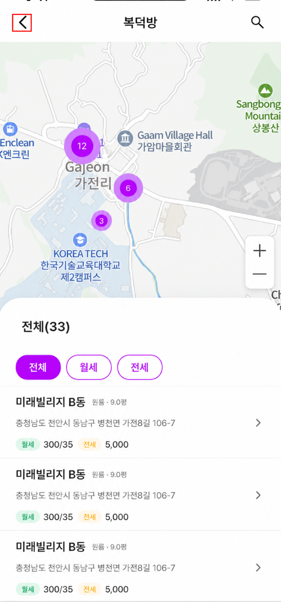

# 2-10 뒤로가기 클릭 (모바일)

[← 로깅 목록](README.md)

생성일: 2026년 11월 19일 오후 2:26
platform: ANDROID, IOS
상태: 로깅 필요

상태: 명세 초안 · 사용자 제공 모바일 디자인 기준. 실제 플랫폼별 구현·배포·수집 미확인.

## 새 로깅 (26.11.17)

- 설명: 복덕방 목록·검색·매물 상세 화면에서 뒤로가기 버튼을 누를 때 클릭 1회당 기록한다. 화면에 관계없이 동일한 event_label을 사용하고, 클릭이 발생한 출발 화면은 source_screen으로 구분한다.
- screen_view: `room_common`
- event_name: `DA1`
- event_label: `real_estate__room_common__navigation__back__click`
- value: 뒤로가기
- event_category: `click`

### 참고사진

**모바일**

**참고사진 · 모바일**

모바일 — 빨간 네모 = 해당 클릭 위치. 사용자 제공 모바일 디자인을 편집한 참고사진이며 iOS·Android별 SDK 구현·배포·실수집 검증 사진은 아니다.