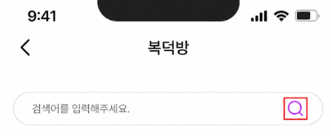

# 2-3 복덕방 목록_검색 실행

[← 로깅 목록](README.md)

생성일: 2026년 11월 19일 오후 2:26
platform: ANDROID, IOS, WEB
상태: 로깅 필요

상태: 명세 초안 · 사용자 제공 WEB 디자인 기준. SDK 구현·배포·실수집 미확인.

## 새 로깅 (26.11.17)

- 설명: 복덕방 검색창에 유효한 검색 조건을 입력한 뒤 검색 아이콘 또는 Enter로 명시적인 검색 요청을 시작할 때 요청 1회당 기록한다.
- screen_view: `room_list`
- event_name: `DA1`
- event_label: `real_estate__room_list__search__submit`
- value: 검색
- event_category: `submit`

### 참고사진

**웹**

**참고사진 · 웹**

사용자 제공 복덕방 WEB 리디자인 참고 이미지다. 실기기·SDK 검증 사진이 아니며 앱 화면으로 분류하지 않는다.

웹 — 빨간 네모가 이 명세의 클릭 대상이다. 같은 화면의 다른 동작은 표시하지 않았다. 사용자 제공 WEB 디자인을 편집한 참고사진이며 실기기·SDK 검증 사진은 아니다.

### 참고사진 · 모바일

