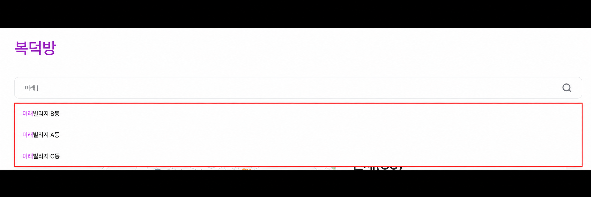
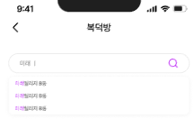

# 2-4 복덕방 목록_추천 검색어 선택

[← 로깅 목록](README.md)

생성일: 2026년 11월 19일 오후 2:26
platform: ANDROID, IOS, WEB
상태: 로깅 필요

상태: 명세 초안 · 사용자 제공 WEB 디자인 기준. SDK 구현·배포·실수집 미확인.

## 새 로깅 (26.11.17)

- 설명: 검색 입력창 아래 표시된 건물명 추천 목록에서 항목을 클릭해 선택할 때 클릭 1회당 기록한다.
- screen_view: `room_list`
- event_name: `DA1`
- event_label: `real_estate__room_list__search_suggestion__select__click`
- value: {선택한 건물명} (예: 미래빌리지 A동)
- event_category: `click`

### 참고사진 **·** **웹**

웹 — 빨간 네모가 이 명세의 클릭 대상이다. 같은 화면의 다른 동작은 표시하지 않았다. 사용자 제공 WEB 디자인을 편집한 참고사진이며 실기기·SDK 검증 사진은 아니다.

### 참고사진 · 모바일

