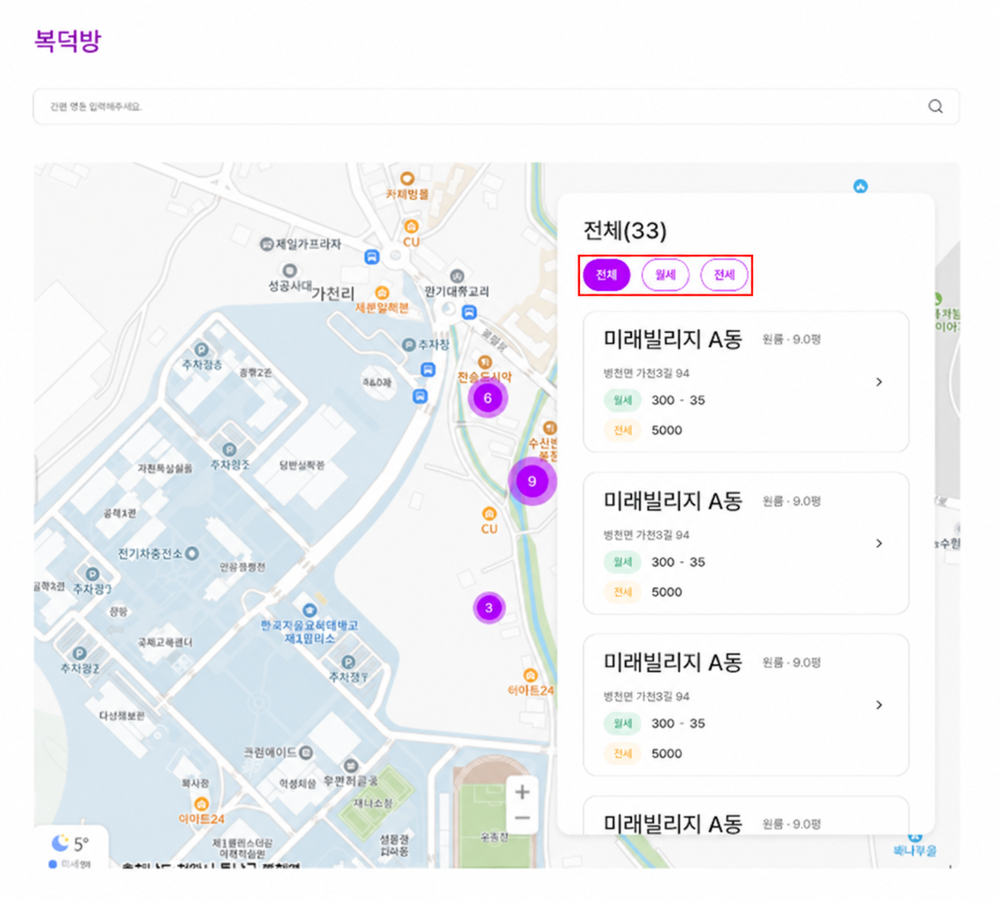
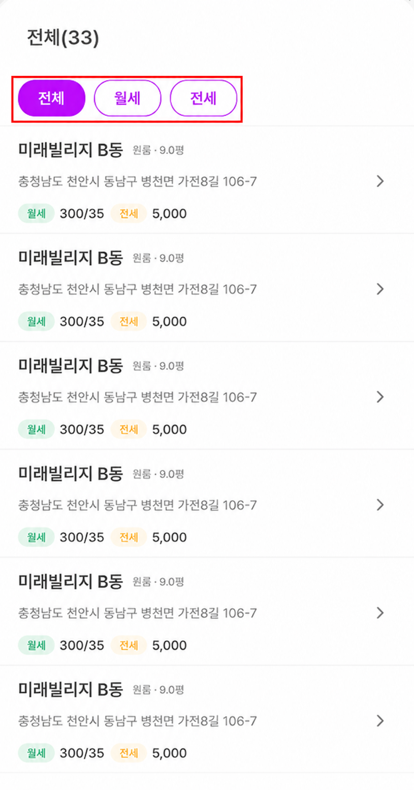

# 2-5 복덕방 목록_거래 유형 필터 선택

[← 로깅 목록](README.md)

생성일: 2026년 11월 19일 오후 2:26
platform: ANDROID, IOS, WEB
상태: 로깅 필요

상태: 명세 초안 · 사용자 제공 WEB 디자인 기준. SDK 구현·배포·실수집 미확인.

## 새 로깅 (26.11.17)

- 설명: 복덕방 매물 목록 상단의 전체·월세·전세 중 현재 선택과 다른 필터를 클릭해 선택이 변경될 때 1회 기록한다.
- screen_view: `room_list`
- event_name: `DA1`
- event_label: `real_estate__room_list__contract_type__select`
- value: 전체 / 월세 / 전세 (예: 월세)
- event_category: `select`

### 참고사진

**웹**

**참고사진 · 웹**

사용자 제공 복덕방 WEB 리디자인 참고 이미지다. 실기기·SDK 검증 사진이 아니며 앱 화면으로 분류하지 않는다.

웹 — 빨간 네모가 이 명세의 클릭 대상이다. 같은 화면의 다른 동작은 표시하지 않았다. 사용자 제공 WEB 디자인을 편집한 참고사진이며 실기기·SDK 검증 사진은 아니다.

### 참고사진 · 모바일

모바일 매물 목록 상단의 전체·월세·전세 버튼도 동일 계약으로 기록한다. 현재와 다른 선택이 적용될 때만 기록하며 기본값 표시·동일 필터 재선택은 제외한다.

모바일 — 빨간 네모 = 해당 클릭·선택 위치. 사용자 제공 디자인을 편집한 참고사진이며 플랫폼별 SDK 구현·실수집 검증 사진은 아니다.